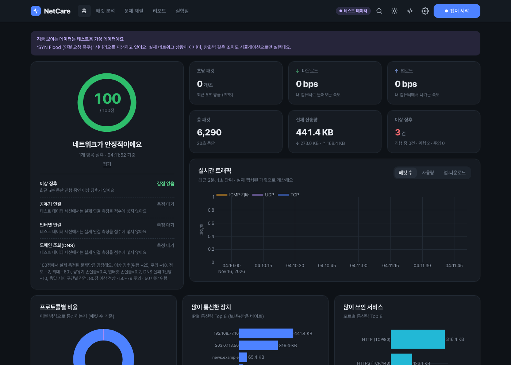
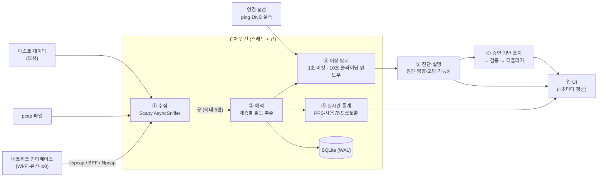
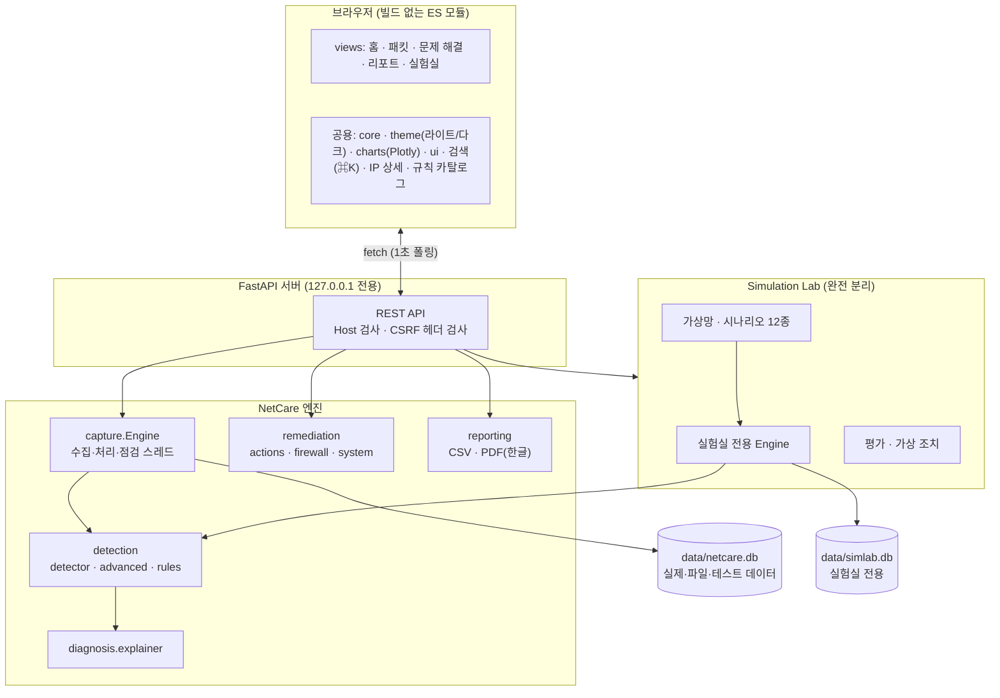
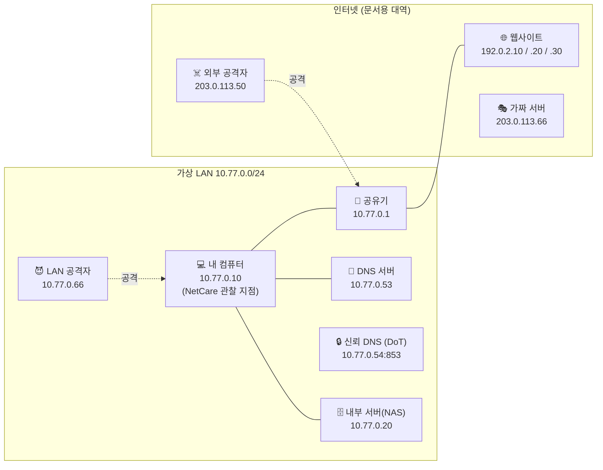
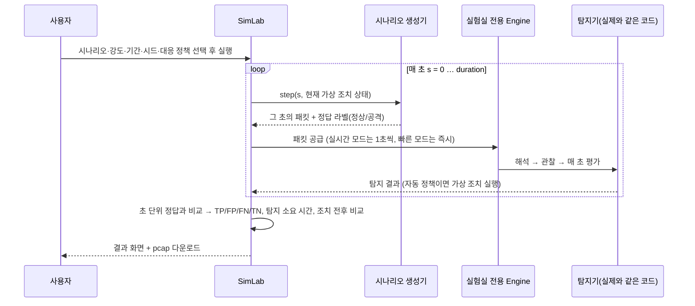

# NetCare

**초보자 친화형 실시간 네트워크 패킷 분석 및 자동 문제 해결 시스템**
Beginner-Friendly Real-Time Network Monitoring and Automated Troubleshooting System

Wireshark 수준의 패킷 분석을 누구나 이해할 수 있는 화면으로 보여 주고, 문제가 생기면
**"탐지 → 원인 설명 → 해결 방법 추천 → 사용자 승인 후 조치 → 효과 검증 → 되돌리기"** 까지 이어 주는 네트워크 관리 프로그램입니다.
여기에 실제 네트워크를 건드리지 않고 공격·장애를 재현해 탐지 성능을 측정하는 **가상 공격 실험실(Simulation Lab)** 이 들어 있습니다.

| 홈 (라이트) | 홈 (다크) |
|---|---|
|  |  |

| 문제 해결 | 가상 공격 실험실 |
|---|---|
|  |  |

> 스크린샷은 모두 **테스트·합성 데이터**로 찍었습니다. 실제 네트워크 정보는 들어 있지 않습니다.

---

## 목차
1. [빠른 시작](#1-빠른-시작)
2. [동작 원리](#2-동작-원리)
3. [시스템 구성](#3-시스템-구성)
4. [이상 탐지 규칙 28종](#4-이상-탐지-규칙-28종)
5. [진단 · 조치 · 상태 점수](#5-진단--조치--상태-점수)
6. [가상 공격 실험실 (Simulation Lab)](#6-가상-공격-실험실-simulation-lab)
7. [CrowdSec 비교와 공개 데이터셋 벤치마크](#7-crowdsec-비교와-공개-데이터셋-벤치마크)
8. [그 밖의 공격 테스트 방법](#8-그-밖의-공격-테스트-방법)
9. [화면 구성과 단축키](#9-화면-구성과-단축키)
10. [안전장치](#10-안전장치)
11. [테스트](#11-테스트)
12. [폴더 구조](#12-폴더-구조)
13. [한계](#13-한계)

---

## 1. 빠른 시작

### 방법 A. 도커로 실행 (권장 · 설치할 것은 Docker 하나)

파이썬, 라이브러리, 캡처 도구, 한글 글꼴이 모두 들어 있는 이미지를 받아 바로 실행합니다. `main`에 올라온 코드는 GitHub Actions가 테스트를 통과한 뒤 자동으로 이미지(amd64·arm64)를 만들어 배포합니다.

```bash
docker run -d --name netcare -p 127.0.0.1:8765:8765 -v netcare-data:/data ghcr.io/tjrdls/netcare:latest
# 브라우저에서 http://127.0.0.1:8765
docker logs -f netcare        # 로그 보기
docker rm -f netcare          # 종료 (기록은 netcare-data 볼륨에 남음)
```

**Linux에서 이 컴퓨터의 실제 인터페이스를 캡처하려면** 호스트 네트워크와 캡처 권한을 줍니다.

```bash
docker run -d --name netcare --network host --cap-add NET_RAW --cap-add NET_ADMIN \
  -e NETCARE_HOST=127.0.0.1 -v netcare-data:/data ghcr.io/tjrdls/netcare:latest
```

저장소를 받았다면 `docker compose up -d`(기본) 또는 `docker compose --profile host-capture up -d netcare-host`(Linux 실제 캡처)로도 실행할 수 있습니다. 이미지를 직접 만들려면 `docker build -t netcare .`을 실행합니다.

| 실행 환경 | 되는 것 | 안 되는 것 |
|---|---|---|
| Linux + `--network host` | 모든 기능 (실제 인터페이스 실시간 캡처 포함) | 방화벽 차단 조치 (컨테이너가 호스트 방화벽을 바꾸지 않도록 꺼 둠) |
| macOS·Windows (Docker Desktop) | 파일 분석, 테스트 데이터, 실험실, 리포트, 컨테이너 내부 트래픽 캡처 | 이 컴퓨터의 Wi-Fi·유선 실시간 캡처 (Docker가 가상 머신 안에서 돌기 때문) → 방법 B 사용 |

- 포트는 반드시 `127.0.0.1:8765:8765`처럼 **127.0.0.1에만** 공개하세요. `-p 8765:8765`로 열면 같은 네트워크의 다른 기기가 접근할 수 있습니다.
- 기록(DB·설정)은 `/data` 볼륨에 저장되어 컨테이너를 지웠다 다시 만들어도 유지됩니다.

### 방법 C. Windows 실행 파일 (파이썬 설치 불필요)

GitHub Actions가 Windows에서 테스트와 실행 점검을 통과한 `NetCare.exe`를 자동으로 만듭니다. 저장소의 **Actions → NetCare CI → 최근 실행 → Artifacts → NetCare-windows-x64**에서 받거나, `netcare-v*` 태그를 붙인 버전은 **Releases**에서 받습니다.

1. 실시간 캡처를 쓰려면 [Npcap](https://npcap.com)을 먼저 설치합니다 (라이선스상 함께 배포할 수 없음). 설치하지 않아도 파일 분석·테스트 데이터·실험실은 동작합니다.
2. `NetCare.exe`를 실행하면 브라우저에서 `http://127.0.0.1:8765`가 열립니다. 방화벽 조치까지 쓰려면 "관리자 권한으로 실행"합니다.
3. 기록은 `%LOCALAPPDATA%\NetCare`에 저장됩니다.

### 방법 B. 파이썬으로 직접 실행 (macOS·Windows 실시간 캡처, 개발용)

Python 3.10 이상이 필요합니다.

```bash
git clone https://github.com/tjrdls/202602CN.git
cd 202602CN/NetCare
python3 -m venv .venv
.venv/bin/pip install -r requirements.txt     # Windows: .venv\Scripts\pip install -r requirements.txt
.venv/bin/python run.py                       # http://127.0.0.1:8765 이 브라우저에서 자동으로 열립니다
```

| OS | 실시간 캡처 준비 |
|---|---|
| macOS | `/dev/bpf*` 읽기 권한 필요. Wireshark의 ChmodBPF를 설치했다면 sudo 없이 캡처되고, 아니면 `sudo .venv/bin/python run.py` |
| Linux | `sudo`로 실행하거나 `sudo setcap cap_net_raw,cap_net_admin=eip $(readlink -f .venv/bin/python)` |
| Windows | [Npcap](https://npcap.com) 설치 후 "관리자 권한으로 실행"한 명령 프롬프트에서 실행 |

- 오른쪽 위 **캡처 시작** → **실시간 캡처** → "추천" 인터페이스를 고르면 수집이 시작됩니다.
- 캡처 권한이 없어도 **파일 분석**(pcap/pcapng), **테스트 데이터**, **실험실**로 모든 화면을 체험할 수 있습니다.
- 다른 기록과 섞이지 않게 따로 띄우려면 `NETCARE_DATA_DIR=/tmp/netcare-demo .venv/bin/python run.py --port 8780` 처럼 실행합니다.
- 서버는 `127.0.0.1`에만 열려 같은 네트워크의 다른 기기에서는 접속할 수 없습니다.

---

## 2. 동작 원리

NetCare는 패킷 하나하나를 **수집 → 해석 → 저장·집계 → 탐지 → 진단 → (승인 시) 조치 → 검증** 하는 파이프라인입니다.



### ① 수집 (Capture)
- `scapy.AsyncSniffer`가 OS의 패킷 캡처 계층(macOS BPF, Linux AF_PACKET, Windows Npcap)에서 프레임을 받아 **크기가 정해진 큐**에 넣습니다. 큐가 가득 차면 버린 패킷 수를 세어 화면에 표시합니다(조용히 잃지 않음).
- BPF 캡처 필터(예: `tcp port 443`)는 시작 전에 문법을 미리 검사합니다.
- 무차별(promiscuous) 모드를 거부하는 Wi-Fi 인터페이스는 자동으로 일반 모드로 다시 시도합니다.

### ② 해석 (Parsing)
`capture/parser.py`가 Ethernet → IPv4/IPv6 → TCP/UDP/ICMP/ARP → DNS/TLS 순서로 필드를 꺼냅니다.
- TCP: 플래그(SYN/ACK/RST/FIN), SEQ/ACK, 윈도우 크기 / IP: TTL, 출발지·목적지 / DNS: 질의 ID·이름·응답 코드·답변
- TLS: 암호화되지 않은 ClientHello의 **SNI(접속하려는 도메인)** 만 읽습니다. **HTTPS 본문은 복호화하지 않으며 볼 수 없습니다.**
- **ECH·ESNI**: 실제 도메인을 암호화하는 ECH(Encrypted Client Hello)·ESNI 확장을 감지합니다. 바깥 SNI가 ECH 공개 이름(예: `cloudflare-ech.com`)이면 "ECH 사용 · 실제 도메인은 암호화됨"으로 표시하고 그 이름을 목적지로 단정하지 않습니다. 브라우저는 ECH를 쓰지 않을 때도 가짜(GREASE) ECH 확장을 붙이므로, 그 밖의 경우에는 "ECH 확장 있음(확정 불가)"으로만 표시합니다. 암호화된 실제 도메인은 복호화하지 않습니다.
- 각 필드에 한국어 설명을 붙이고(`analysis/terms.py`), 화면용 쉬운 문장("내 컴퓨터 → github.com 으로 보안 웹 접속")을 만듭니다.
- 방향(업로드/다운로드)은 내 컴퓨터의 IP·MAC 목록을 기준으로 판단합니다.

### ③ 저장과 실시간 통계
- 처리 스레드는 패킷을 최대 500개(또는 0.3초)씩 묶어 SQLite에 저장합니다. WAL 모드라 화면 조회와 쓰기가 서로 막지 않습니다.
- 보존 한도(기본 패킷 수 제한)를 넘으면 오래된 패킷부터 지웁니다. 탐지 결과와 조치 기록은 따로 보존합니다.
- PPS, 업·다운로드 속도, 프로토콜·IP·포트별 순위를 메모리에서 바로 집계해 1초마다 화면에 보냅니다.

### ④ 이상 탐지 (Detection)
- 패킷을 **1초 단위 버킷**에 요약하고(SYN 수, 응답 수, 포트별 개수, DNS 질의·오류 등), 매 초 **최근 10초 슬라이딩 윈도우**로 규칙을 평가합니다.
- **규칙 기반 탐지**: "10초 안에 순수 SYN 60개 이상 + 핸드셰이크 완료율 낮음" 처럼 근거가 분명한 조건.
- **통계 기반 탐지**: 트래픽 급증은 평소 사용량을 **EWMA(지수가중이동평균)** 로 학습한 뒤 **z-score**가 기준을 넘을 때만 판단합니다. 프로토콜 비율 이상도 학습된 기준선과 비교합니다.
- **오탐 완화**: 양방향 통신인지, 핸드셰이크가 정상 완료되는지, HTTPS 같은 일반 서비스 포트인지, mDNS·DNS-SD처럼 원래 '없음'이 정상인 조회인지를 함께 봅니다.
- **확실성 구분**: 패킷만으로 확정할 수 없는 공격(IP·DNS 스푸핑 등)은 반드시 **'의심'** 으로 표시하고 심각도를 낮게 제한합니다.
- 같은 문제가 계속되면 새 경보를 쌓지 않고 기존 경보의 지속 시간과 측정값을 갱신합니다.

### ⑤ 진단·설명 (Diagnosis)
`diagnosis/explainer.py`가 탐지 결과를 **무엇이 / 누가 / 어떤 프로토콜로 / 왜 문제인지 / 어떤 영향이 있는지 / 오탐일 가능성** 으로 풀어 쓰고, 그 문제에 **관련 있는 조치만** 추천합니다. 진단과 설명은 모두 규칙 기반이라 AI나 외부 서비스 없이 동작합니다.

### ⑥ 조치 → 검증 → 되돌리기 (Remediation)
1. **미리보기**: 실행할 명령, 영향, 부작용, 필요한 권한을 먼저 보여 줍니다.
2. **승인**: 시스템을 바꾸는 조치는 "이해했어요" 체크와 확인이 모두 있어야 실행됩니다(API도 `confirm` + `acknowledge_risk`를 검사).
3. **실행**: 연결 점검, DNS 테스트, DNS 캐시 초기화, 통신 내역 확인, 프로세스 찾기, 방화벽 IP 차단 등.
4. **효과 검증**: 조치 후 같은 지표를 다시 측정해 실제로 좋아졌는지 보여 줍니다.
5. **되돌리기**: 실행 전 상태를 기록해 두고 NetCare가 만든 규칙만 정확히 지웁니다.

---

## 3. 시스템 구성



### 모듈별 역할

| 계층 | 모듈 | 역할 |
|---|---|---|
| 진입점 | `run.py` | 인자 처리(`--port`, `--no-browser`), 서버 실행, 브라우저 열기 |
| 설정 | `netcare/config.py` | 탐지 임계값·보존 한도·점검 주기 등. `data/config.json`에 저장하며 값 범위를 검증 |
| 수집 | `netcare/capture/` | `interfaces.py`(인터페이스 목록·추천), `parser.py`(계층 해석), `engine.py`(스레드·큐·세션 관리) |
| 분석 | `netcare/analysis/` | `stats.py`(실시간 통계), `probe.py`(ping·DNS 실측), `health.py`(상태 점수), `terms.py`(용어 번역) |
| 탐지 | `netcare/detection/` | `detector.py`(기본 규칙 + EWMA), `advanced.py`(스푸핑·품질·확장 규칙), `rules.py`(규칙 카탈로그) |
| 진단 | `netcare/diagnosis/explainer.py` | 원인·영향·오탐 가능성 설명, 관련 조치 추천 |
| 조치 | `netcare/remediation/` | `actions.py`(승인·검증·롤백), `firewall.py`(OS별 방화벽), `system.py`(권한·명령 실행) |
| 저장 | `netcare/storage/db.py` | SQLite(WAL), 인덱스, 필터·정렬·페이지 조회, 리포트 쿼리, 검색 |
| 리포트 | `netcare/reporting/export.py` | CSV 5종, 한글 PDF |
| 테스트 데이터 | `netcare/testdata/synthetic.py` | 합성 시나리오 5종 (`[테스트 데이터]` 배지로 구분) |
| 실험실 | `netcare/simlab/` | `network.py`(가상망), `scenarios.py`(시나리오 12종), `evaluate.py`(지표), `lab.py`(실험 관리) |
| API | `netcare/api/server.py` | REST API 약 50개 + 정적 파일 제공 |
| UI | `netcare/web/` | `css/`(디자인 토큰·컴포넌트·화면), `js/`(ES 모듈), `ui-kit.html`(컴포넌트 미리보기) |

### 스레드 구조
| 스레드 | 하는 일 |
|---|---|
| 캡처(AsyncSniffer) | 인터페이스에서 프레임을 받아 큐에 넣기만 함 (가장 가볍게) |
| `netcare-processor` | 큐에서 꺼내 해석 → 통계 → 탐지기 관찰 → 묶음 저장 |
| `netcare-ticker` | 매 초 탐지 규칙 평가, 진행 중인 경보 갱신 |
| `netcare-prober` | 주기적으로 공유기·인터넷 ping, DNS 조회 실측 |
| `netcare-pcap` / `-test` / `-simlab` | 파일·테스트·실험실 패킷을 같은 처리 경로로 공급 |

캡처와 처리를 분리했기 때문에 트래픽이 몰려도 캡처가 막히지 않고, 처리가 따라가지 못하면 버린 패킷 수가 정직하게 표시됩니다.

### 데이터 출처 구분
모든 세션에는 출처가 붙습니다: **실시간 캡처(live) / pcap 파일(pcap) / 테스트 데이터(test) / 실험실(sim)**.
화면은 항상 출처 배지를 보여 주고, 리포트는 기본으로 **실제 캡처만** 집계합니다. 실험실 데이터는 아예 다른 DB 파일에 저장됩니다.

### 주요 API
| 분류 | 엔드포인트 |
|---|---|
| 캡처 | `GET /api/interfaces`, `POST /api/capture/start·stop·import`, `POST /api/test/run` |
| 화면 데이터 | `GET /api/dashboard`, `/api/stats`, `/api/packets`(ip·port·정렬·페이지), `/api/packets/{id}`, `/api/ip/{ip}`, `/api/search` |
| 탐지·규칙 | `GET /api/anomalies`, `/api/anomalies/{id}`, `/api/rules`, `/api/rules/{type}` |
| 조치 | `GET /api/actions/catalog`, `POST /api/actions/preview·execute`, `POST /api/actions/{id}/verify·rollback` |
| 리포트 | `GET /api/report`, `/api/export/{kind}.csv`, `/api/export/report.pdf` |
| 실험실 | `GET /api/lab/scenarios`, `POST /api/lab/run·stop·pause`, `/api/lab/experiments`, `/api/lab/benchmark`, `/api/lab/actions/execute` |

---

## 4. 이상 탐지 규칙 28종

화면의 **문제 해결 → 📐 탐지 규칙 보기** 에서 각 규칙의 조건(현재 임계값 반영), 근거, 오탐 가능성, 한계를 볼 수 있습니다.

| # | 규칙 | 분류 | 근거 | 심각도 | 확실성 |
|---|---|---|---|---|---|
| 1 | 특정 장치의 과도한 패킷 | 사용량 | 패킷 | 정보~위험 | 측정 |
| 2 | SYN Flood (새 연결 요청 급증) | 공격 | 패킷 | 주의~위험 | 측정 |
| 3 | 특정 포트 집중 | 사용량 | 패킷 | 정보~주의 | 측정 |
| 4 | 네트워크 사용량 급증 | 사용량 | 통계(EWMA z-score) | 정보~주의 | 측정 |
| 5 | 반복되는 연결 시도 | 공격 | 패킷 | 주의~위험 | 측정 |
| 6 | 포트 스캔 | 공격 | 패킷 | 주의~위험 | 측정 |
| 7 | 특정 장치와의 과도한 통신 | 사용량 | 패킷 | 정보 | 측정 |
| 8 | DNS 조회 실패 | DNS | 패킷 | 주의~위험 | 측정 |
| 9 | 공유기(게이트웨이) 연결 끊김 | 품질 | ping 실측 | 위험 | 측정 |
| 10 | 데이터 손실 (ping) | 품질 | ping 실측 | 주의~위험 | 측정 |
| 11 | 네트워크 지연 (ping) | 품질 | ping 실측 | 주의 | 측정 |
| 12 | ARP 스푸핑 | 스푸핑 | 패킷 | 주의(게이트웨이 사칭이면 위험) | 가능성 높음 |
| 13 | IP 스푸핑(출발지 위조) | 스푸핑 | 패킷 | 최대 주의 | **의심** |
| 14 | DNS 응답 위조 | 스푸핑 | 패킷 | 최대 주의 | **의심** |
| 15 | 지연 증가 (패킷 기반 RTT) | 품질 | 패킷 | 주의 | 측정 |
| 16 | 지터(지연 불규칙) | 품질 | 패킷 | 주의 | 측정 |
| 17 | 데이터 손실 (TCP 재전송) | 품질 | 패킷 | 주의~위험 | 측정 |
| 18 | 서버 연결 중단 | 품질 | 패킷 | 주의~위험 | 측정 |
| 19 | 대역폭 제한 | 품질 | 패킷 | 정보 | **의심** |
| 20 | 비정상 패킷 크기 (큰 ICMP·DNS) | 공격 | 패킷 | 정보 | **의심** |
| 21 | 프로토콜 비율 이상 | 사용량 | 통계(학습 기준선) | 정보 | **의심** |
| 22 | 존재하지 않는 도메인(NXDOMAIN) 조회 급증 | DNS | 패킷 | 정보 | **의심** |
| 23 | 체크섬 오류 (비트 변조·손상 패킷) | 패킷 무결성 | 패킷 | 정보~주의 | **의심** |
| 24 | TCP 주입 (RST·데이터) | 패킷 무결성 | 패킷 | 주의 | **의심** |
| 25 | UDP 재전송(리플레이)·순서 번호 중복 | 패킷 무결성 | 패킷 | 주의 | **의심** |
| 26 | 웹 공격 시도 (민감 파일·경로 조작·SQL 인젝션·XSS·백도어·Log4Shell 등) | 공격 | 평문 HTTP | 주의~위험 | 측정 (시도 여부) |
| 27 | 웹 탐색·크롤링·공격 도구 User-Agent | 공격 | 평문 HTTP | 정보~주의 | 측정 |
| 28 | 로그인 무차별 대입 (FTP·SSH·웹 로그인) | 공격 | 패킷 | 주의 | 가능성 높음 (SSH는 의심) |

몇 가지 규칙의 판단 방식:
- **SYN Flood**: 10초 안의 순수 SYN 수가 임계값(기본 60)을 넘고, 그 연결들의 핸드셰이크 완료율이 낮을 때. 완료율 0%에 출발지가 분산돼 있으면 '위험'.
- **포트 스캔**: 한 출발지가 10초 안에 서로 다른 목적지:포트 40곳 이상을 두드리고 대부분 RST/무응답일 때.
- **ARP 스푸핑**: 내 서브넷 안의 같은 IP를 서로 다른 MAC이 주장할 때. 공유기 IP를 사칭하면 '위험'.
- **DNS 응답 위조**: 같은 질의 ID에 서로 다른 답이 두 번 오는 경합(먼저 온 쪽이 가짜일 수 있음). 처음부터 위조 응답 하나만 오면 구분할 수 없어 '의심'까지만 판정합니다.
- **체크섬 오류**: 수신 패킷의 IP 헤더·TCP·UDP·ICMP 체크섬을 다시 계산해 내용과 맞지 않으면 비트 변조·손상으로 의심합니다. 내가 보낸 패킷은 NIC 체크섬 오프로드 때문에 검사하지 않습니다.
- **TCP 주입**: 연결(방향)마다 TTL 최빈값과 다음 예상 순서 번호(SEQ)를 추적해, 평소 TTL과 다른 RST·데이터, 순서 번호가 크게 벗어난 RST, RST 뒤에도 이어지는 데이터를 찾습니다.
- **UDP 재전송**: RTP(음성·영상 통화)는 자동으로, 자체 UDP 프로토콜은 설정 `udp_seq_ports`(예: `"9999:0:4"` = 9999번 포트, 페이로드 0바이트 위치의 4바이트 순서 번호)로 순서 번호를 읽어 같은 번호가 다시 오면 재전송(리플레이)으로 의심합니다.
- **프로토콜 비율 이상**: 평소 TCP/UDP/ICMP 비율을 60초 이상 학습한 뒤, 초당 100패킷 이상에서 비율이 크게 바뀔 때만.

---

## 5. 진단 · 조치 · 상태 점수

### 종합 상태 점수
100점에서 **실측 근거가 있을 때만** 감점합니다. 측정하지 않은 항목은 감점하지 않고, 화면에 감점 근거를 모두 공개합니다.

| 항목 | 근거 | 감점 |
|---|---|---|
| 진행 중 이상 징후 | 최근 5분 탐지 | 위험 25 · 주의 10 · 정보 2 (최대 60) |
| 공유기 연결 | ping 실측 | 손실률×0.4 (최대 40), 평균 지연 100ms↑ 5 / 300ms↑ 15 |
| 인터넷 연결 | ping 실측 | 손실률×0.2 (최대 20), 평균 지연 150ms↑ 5 / 400ms↑ 10 |
| DNS | 실제 조회 | 실패 1건당 10 (최대 20), 평균 500ms↑ 5 |

80점 이상: 정상 · 50~79점: 주의 · 50점 미만: 위험

### 조치 목록
| 조치 | 시스템 변경 | 설명 |
|---|---|---|
| 연결 점검 / DNS 테스트 | 없음 | 공유기·인터넷 ping, 여러 DNS 서버로 조회해 원인 구간을 좁힘 |
| 통신 내역 확인 / 프로세스 찾기 | 없음 | 어떤 프로그램이 그 IP·포트와 통신하는지 확인 |
| DNS 캐시 초기화 | 있음 | 오래된·잘못된 DNS 기록 삭제 |
| 방화벽 IP 차단 | 있음 | macOS pf anchor / Linux iptables comment / Windows 방화벽 규칙. NetCare 전용 규칙만 만들고 지움 |

---

## 6. 가상 공격 실험실 (Simulation Lab)

### 왜 필요한가
실제 네트워크에 공격 패킷을 보내는 것은 위험하고, 대부분 불법입니다. 그런데 탐지 기능이 정말 동작하는지는 공격을 재현해 봐야 알 수 있습니다.
실험실은 **메모리 안의 가상 네트워크**에서 공격·장애 패킷을 만들어 **실제 탐지 엔진과 같은 코드**로 분석하고, **정답(언제 공격이 있었는지)** 과 비교해 탐지 성능을 숫자로 측정합니다.

### 안전 분리 원칙
| 원칙 | 구현 |
|---|---|
| 패킷을 네트워크로 보내지 않는다 | `simlab/network.py`는 Scapy 패킷 **객체만** 만들고, `send`/`sendp`/`sr` 같은 전송 함수를 import 하지 않습니다(정적 검사 테스트) |
| 실제 시스템을 바꾸지 않는다 | 실험실 조치는 가상 상태(`Effects`)만 바꿉니다. 실제 방화벽·시스템 명령 모듈을 import 하지 않으며, 테스트에서 실제 명령 실행 함수를 예외로 바꿔도 통과합니다 |
| 실제 데이터와 섞지 않는다 | 실험실 전용 `Engine` 인스턴스 + 전용 DB `data/simlab.db`. 실험 후 실제 DB 행 수가 그대로인지 테스트합니다 |
| 실제 주소를 쓰지 않는다 | 사설 대역 `10.77.0.0/24`와 문서용 예제 대역(`192.0.2.0/24`, `203.0.113.0/24`)만 사용합니다 |
| 결과를 숨기지 않는다 | 모든 화면과 리포트에 **[합성 데이터]** 로 표시합니다 |

### 가상 네트워크 구성



NetCare는 '내 컴퓨터'의 인터페이스를 캡처한다고 가정합니다. 그래서 실제 환경과 같이 **내 컴퓨터에 보이는 패킷만** 탐지에 쓰입니다.

### 시나리오 12종 (+ 정상 기준선)

| 종류 | 시나리오 | 재현 내용 | 기대 탐지 | 가상 조치 |
|---|---|---|---|---|
| 기준선 | 정상 트래픽 | 웹·DNS·스트리밍·내부 서버 접속만 발생 | 없음 (오탐 측정용) | - |
| 공격 | IP Spoofing | 내 주소 도용, LAN 장치 사칭(MAC 불일치), 예약 주소, TTL 급변, 요청 없는 SYN-ACK | IP 스푸핑 **의심** | 공유기 인그레스 필터링 |
| 공격 | ARP Spoofing | "공유기 IP = 공격자 MAC" 위조 ARP 응답 반복 → 트래픽 가로채기 | ARP 스푸핑 | 정적 ARP (공유기 MAC 고정) |
| 공격 | DNS Spoofing | 진짜 DNS보다 먼저 가짜 IP를 담은 응답을 보냄 (경합 위조) | DNS 위조 **의심** | 암호화 DNS(DoT) 전환 |
| 공격 | Port Scanning | LAN 공격자가 내 TCP·UDP 포트를 차례로 두드림 | 포트 스캔 | 내 컴퓨터 방화벽 차단 |
| 공격 | SYN Flood | 외부 공격자가 핸드셰이크를 끝맺지 않는 SYN 대량 전송 | SYN 급증 | 내 컴퓨터 방화벽 차단 |
| 공격 | 반복 연결 요청 | 닫힌 원격 데스크톱(3389)에 연결을 반복 시도 | 반복 연결 | 내 컴퓨터 방화벽 차단 |
| 장애 | Packet Loss | 데이터 일부 손실 → 재전송·중복 ACK 증가 | TCP 손실 | 진단 + 장애 종료 |
| 장애 | Latency | 모든 응답이 고정적으로 늦게 도착 | 지연 증가 | 진단 + 장애 종료 |
| 장애 | Jitter | 응답 지연이 매번 불규칙 | 지터 | 진단 + 장애 종료 |
| 장애 | DNS Failure | DNS 서버가 SERVFAIL을 주거나 응답 없음 | DNS 실패 | 암호화 DNS 전환 |
| 장애 | Bandwidth Limiting | 회선 속도 제한 + 대기열로 지연 증가 | 대역폭 제한 **의심** | 진단 + 장애 종료 |
| 장애 | Connection Failure | 평소 쓰던 내부 서버가 응답을 멈춤 | 연결 중단 | 진단 + 장애 종료 |

> "장애 주입 종료"는 NetCare가 장애를 고친 것이 아니라 **실험 조건을 바꾼 것**입니다. 화면과 기록에서 NetCare의 해결 기능과 구분해 표시합니다.

### 실험 한 번이 진행되는 방식



- **조절 가능한 조건**: 강도(0.05~5배), 전체 길이(15~180초), 공격 구간(기본 12~32초), 시드, 배경 트래픽 유무.
- **실행 속도**: 빠르게(결과 즉시) / 실시간(1초씩 흘러가며 그래프와 탐지가 나타남, **⏸ 일시정지** 가능).
- **대응 정책**: 조치 없음(결과 화면에서 사용자가 가상 조치를 직접 실행할 수 있음) / 탐지 시 권장 가상 조치(기대한 유형이 탐지되면 권장 가상 조치를 자동 실행).
- **재현성**: 같은 시나리오·조건·시드면 패킷 바이트와 시각의 해시, 탐지 지표가 항상 같습니다(테스트로 검증). 실험마다 pcap을 내려받아 Wireshark로 열어 볼 수 있습니다.

### 평가 방법
1초마다 "그 초에 공격이 있었나(정답)"와 "그 초에 기대한 탐지가 켜져 있었나(예측)"를 비교합니다.

| 판정 | 의미 |
|---|---|
| TP | 공격 구간인데 기대한 유형을 탐지 |
| FN | 공격 구간인데 탐지하지 못함 |
| FP | 정상 구간인데 무언가를 탐지 (공격과 무관한 유형도 FP) |
| TN | 정상 구간이고 아무것도 탐지하지 않음 |

- 지표: **Precision, Recall, F1, FPR**, 그리고 **탐지 소요 시간**(공격 시작 → 첫 기대 탐지).
- 공격이 끝난 직후 윈도우(10초) 동안은 관련 경보가 남아 있어도 FP로 세지 않습니다(슬라이딩 윈도우 특성).
- 관련은 있지만 기대 유형이 아닌 탐지(예: SYN Flood 중의 '반복 연결')는 오탐으로 세지 않습니다.
- 조치를 실행한 뒤에는 공격 결과가 달라지므로, 그 이후 구간은 지표에서 빼고 **조치 전후 비교**로 따로 봅니다.
- **조치 전후 비교**: 조치 직전 최대 10초 vs 조치 2초 뒤부터 10초의 지표 평균 (예: 공격자에게 보낸 SYN-ACK/초, 공격자 MAC으로 간 내 프레임/초).

### 벤치마크 결과 (합성 데이터 기준)
시나리오 12종 + 정상 기준선을 강도·시드를 바꿔 156회 실행했습니다. 아래는 강도 1×(39회) 결과입니다.

| 시나리오 | 탐지율 | 평균 소요 | Precision | Recall | F1 | FPR |
|---|---|---|---|---|---|---|
| 정상 (기준선) | - | - | - | - | - | **0%** |
| ARP Spoofing | 100% | 1.0초 | 100% | 100% | 100% | 0% |
| DNS Spoofing | 100% | 1.0초 | 100% | 100% | 100% | 0% |
| IP Spoofing | 100% | 2.0초 | 100% | 95% | 97.4% | 0% |
| Port Scanning | 100% | 2.0초 | 100% | 95% | 97.4% | 0% |
| 반복 연결 | 100% | 3.0초 | 100% | 90% | 94.7% | 0% |
| SYN Flood | 100% | 3.0초 | 100% | 90% | 94.7% | 0% |
| Connection Failure | 100% | 2.0초 | 100% | 95% | 97.4% | 0% |
| Latency | 100% | 5.7초 | 100% | 76.7% | 86.8% | 0% |
| Jitter | 100% | 8.7초 | 100% | 61.7% | 76.3% | 0% |
| DNS Failure | 100% | 7.0초 | 100% | 70% | 82.4% | 0% |
| Packet Loss | 100% | 8.0초 | 100% | 65% | 78.8% | 0% |
| Bandwidth (의심) | 100% | 10.0초 | 100% | 55% | 71.0% | 0% |
| **전체** | | | **100%** | **82.8%** | **90.6%** | **0%** |

낮은 강도를 포함한 전체 156회: Precision 100%, Recall 66.4%, F1 79.8%, FPR 0%.

**결과를 읽을 때 주의할 점**
- 이 숫자는 **우리가 만든 합성 시나리오에 대한 결과**이고, 실제 네트워크의 탐지율을 보장하지 않습니다.
- Recall이 100%가 아닌 이유는 대부분 **탐지 소요 시간**입니다. 품질 장애는 충분한 근거(여러 초의 RTT·재전송)가 모여야 판단하므로 공격 초반 몇 초가 FN이 됩니다.
- 벤치마크는 확장 규칙 3종(비정상 패킷 크기·프로토콜 비율·NXDOMAIN 급증)을 추가하기 전 코드로 측정했습니다. 새 규칙이 기존 시나리오에서 오탐을 내지 않는지는 별도 테스트로 확인했습니다.
- 자세한 과정과 수정 이력은 [docs/05_시뮬레이션랩_결과.md](docs/05_시뮬레이션랩_결과.md)에 있습니다.

### 실험실 사용법
1. 상단 **실험실** 탭(단축키 `5`)으로 이동합니다.
2. 시나리오 카드를 고릅니다. 카드에 실험 목적과 난이도(탐지하기 까다로운 정도)가 있고, 실행 전에 "실행하면 이렇게 돼요" 안내가 나옵니다.
3. 강도·기간·실행 속도(빠르게/실시간)·대응(조치 없음/권장 가상 조치 자동)을 정하고 **▶ 실험 실행**을 누릅니다.
4. 실시간 모드에서는 그래프에 공격 구간과 탐지 시점이 표시되고, **⏸ 일시정지**로 멈춰 설명할 수 있습니다.
5. 결과에서 탐지 소요 시간, P/R/F1/FPR, 초 단위 타임라인, 오탐 목록, 가상 조치 전후 비교를 확인하고 pcap을 내려받습니다.
6. **벤치마크**는 모든 시나리오를 강도·반복 조건별로 한 번에 돌려 표로 정리합니다.

---

## 7. CrowdSec 비교와 공개 데이터셋 벤치마크

[CrowdSec](https://www.crowdsec.net)은 웹 서버·sshd·방화벽 **로그**를 읽어 leaky bucket 시나리오로 공격을 찾는 오픈소스 보안 엔진입니다. NetCare는 로그 대신 **패킷**에서 같은 사건을 만들어, CrowdSec과 **같은 조건**(용량·누수 속도·distinct·패턴 목록)으로 판정합니다 (`netcare/detection/crowdsec_compat.py`).

| NetCare가 패킷에서 만든 사건 | 같은 조건의 CrowdSec 시나리오 |
|---|---|
| 평문 HTTP 요청의 경로·인자·User-Agent | `http-sensitive-files`, `http-path-traversal-probing`, `http-sqli-probing`, `http-xss-probing`, `http-backdoors-attempts`, `http-bad-user-agent`, `http-crawl-non_statics`, `apache_log4j2_cve-2021-44228`, `http-cve-2021-41773/42013` |
| 평문 HTTP 응답 코드 (요청과 짝지음) | `http-probing`, `http-admin-interface-probing` |
| FTP 응답 530 (로그인 실패) | `vsftpd-bf` |
| SSH 연결 시도 | `ssh-bf` (암호화로 인증 실패를 볼 수 없어 연결 수로 근사 → '의심') |
| 열려 있지 않은 포트로 온 SYN | `iptables-scan-multi_ports` |

패턴 목록은 CrowdSec Hub 데이터를 그대로 씁니다(MIT, `netcare/detection/data/crowdsec/NOTICE.md`).

**NetCare 확장 (CrowdSec에 없는 조건, 근거에 `netcare_extension`으로 표시)**
- URL 디코딩 후 비교: CrowdSec은 로그에 적힌 그대로(인코딩된 상태) 비교해 `%3Cscript%3E` 같은 인코딩된 공격을 놓칩니다.
- SQL 인젝션 문법 휴리스틱: `' and 1=1`, `order by 3`, `union select`, 따옴표 뒤 주석 등 느린 수동 공격.
- 웹 로그인 무차별 대입: 실패 응답이 401/403이 아니라 302·200인 앱(DVWA 등)도 같은 로그인 경로 POST 반복으로 잡습니다.

**차이와 한계를 정직하게**
- CrowdSec은 HTTPS 서버의 로그도 읽지만, NetCare는 HTTPS 내용을 복호화하지 않으므로 HTTPS 웹 공격은 판정하지 못합니다.
- 반대로 NetCare는 로그가 없는 장비·서비스(스캔, SYN Flood, 스푸핑, 체크섬 변조, TCP 주입 등)도 패킷만으로 봅니다.

### 공개 데이터셋 벤치마크 (CSE-CIC-IDS2018)

직접 만든 공격이 아니라 **공개 라벨 데이터셋**으로 평가합니다. GitHub Actions(`.github/workflows/netcare-bench.yml`)가 다음을 자동으로 수행하고 결과를 [docs/benchmark/cse-cic-ids2018.md](docs/benchmark/cse-cic-ids2018.md)에 기록합니다.

1. CIC·CSE의 [CSE-CIC-IDS2018](https://www.unb.ca/cic/datasets/ids-2018.html) 공개 버킷에서 공격받은 서버의 캡처만 내려받습니다 (FTP·SSH 무차별 대입: 2018-02-14 / 웹 로그인 무차별 대입·XSS·SQL 인젝션: 2018-02-22, 23).
2. NetCare가 pcap을 분석합니다 (실제 엔진과 같은 `parse_packet → Detector`).
3. 같은 패킷에서 만든 Apache 접근 로그·vsftpd 로그를 **실제 CrowdSec**(time-machine 모드, 중앙 서버 전송 끔)에 넣습니다.
4. 데이터셋 라벨(CICFlowMeter CSV)과 비교해 공격별 탐지 여부·소요 시간, 라벨 밖 알림을 표로 만듭니다.

로컬에서는 `python scripts/bench/cse_cic_ids2018.py --case web_thu --out bench-out`으로 한 사례를 돌릴 수 있습니다 (`pip install remotezip` 필요). 6장의 가상 실험실은 탐지 로직 회귀 확인용 보조 지표이고, 성능 근거는 이 공개 데이터셋 결과입니다.

---

## 8. 그 밖의 공격 테스트 방법

| 방법 | 어디서 | 무엇을 확인하나 |
|---|---|---|
| **테스트 데이터 5종** | 캡처 시작 → 테스트 데이터 | 평상시 웹 사용 / SYN Flood / 포트 스캔 / DNS 장애 / 트래픽 급증(오탐 완화 확인)을 실제 화면 흐름(탐지 → 설명 → 조치 → 검증 → 되돌리기)으로 체험. 조치는 시뮬레이션만 하고 시스템을 바꾸지 않음 |
| **루프백 트래픽 실험** | `scripts/traffic_lab.py` + `lo0`(Linux는 `lo`) 캡처 | 진짜 OS 패킷으로 탐지 검증. 대상이 `127.0.0.1`로 고정되어 다른 장치로는 아무것도 보내지 않음 |
| **pcap 파일 분석** | 캡처 시작 → 파일 분석 | Wireshark 등으로 저장한 pcap/pcapng 재생, 실험실 결과 pcap도 가능 |

```bash
# 터미널 1: NetCare 실행 후 화면에서 lo0 인터페이스로 실시간 캡처 시작
.venv/bin/python run.py
# 터미널 2
.venv/bin/python scripts/traffic_lab.py scan     # 닫힌 포트 여러 개 → 포트 스캔 / SYN 급증
.venv/bin/python scripts/traffic_lab.py repeat   # 같은 닫힌 포트 반복 → 반복 연결
.venv/bin/python scripts/traffic_lab.py udp      # UDP 대량 전송 → 과다 패킷
.venv/bin/python scripts/traffic_lab.py bulk     # 대용량 TCP → 트래픽 급증 + 오탐 완화(양방향)
.venv/bin/python scripts/traffic_lab.py normal   # 정상 연결 → 오탐이 없어야 함
```

---

## 9. 화면 구성과 단축키

| 화면 | 내용 |
|---|---|
| **홈** | 종합 상태 점수(감점 근거), PPS, 업/다운로드, 총 패킷·전송량, 최근 탐지, 실시간 그래프, 주요 통신 장치, 세부 통계, 연결 점검 |
| **패킷 분석** | 쉬운 문장 / 전문가 컬럼, 필터 칩, IP·포트 필터, 열 정렬, 페이지, 오른쪽 상세 패널(계층 트리·헥사 덤프) |
| **문제 해결** | 이상 징후 목록 → ①~⑦ 단계(무엇이·근거·원인·영향·오탐 가능성·추천 조치·검증), 기준 대비 비교, 타임라인, 탐지 규칙 카탈로그 |
| **리포트** | 기간(오늘·7일·30일·90일·직접 선택), 사용량·상태 추이, 위험 수준별 탐지, 조치 결과, 실험실 요약, CSV·PDF 내보내기 |
| **실험실** | 시나리오 카드, 실행 조건, 실시간 그래프, 결과 평가, 가상 조치, 벤치마크 |

| 키 | 동작 |
|---|---|
| `⌘K` / `Ctrl+K` | 전역 검색 (IP·도메인·포트·이상 징후·규칙) |
| `1`~`5` | 화면 이동 |
| `d` | 라이트/다크 전환 (기본은 OS 설정을 따름) |
| `e` | 전문가 모드 (원본 필드 이름·헥사 덤프·실행 명령 표시) |
| `/` | 패킷 검색 |
| `?` | 단축키 목록 |

색은 의미로만 씁니다: 파랑·청록 = 기본, 초록 = 정상, 주황 = 주의, 빨강 = 위험, 보라 = 시뮬레이션.

---

## 10. 안전장치

- **자동 차단은 기본으로 꺼져 있습니다.** 켜려면 경고에 동의해야 하고, 켜져 있어도 외부 공인 IP의 '위험' 등급 SYN 급증·포트 스캔·단방향 폭주에만 적용하며 30분 뒤 자동 해제됩니다.
- 시스템을 바꾸는 조치는 `confirm`과 `acknowledge_risk`가 모두 있어야 실행됩니다.
- 내 IP, 게이트웨이, DNS 서버, 루프백·멀티캐스트·브로드캐스트·링크로컬 주소, 화이트리스트는 차단을 거부합니다.
- NetCare 전용 규칙만 만들고 지웁니다 (macOS `com.apple/netcare` anchor, Linux `NetCare` comment, Windows `NetCare-Block-*`). 실행 전 상태를 기록해 롤백합니다.
- 관리자 권한이 필요하면 몰래 실행하지 않고 직접 실행할 명령을 보여 줍니다.
- 테스트 데이터와 실험실에서 나온 징후로는 시스템을 바꾸지 않습니다.
- 로컬 API 보호: Host 헤더 검사(DNS 리바인딩 방지), 변경 요청에 커스텀 헤더 `X-NetCare: 1` 필수(CSRF 방지).
- HTTPS 본문은 복호화하지 않습니다. 볼 수 있는 것은 헤더와 평문 SNI뿐이며, ECH로 숨긴 도메인도 복호화하지 않습니다.
- **내가 관리하는 네트워크에서만 사용하세요.** NetCare는 진단과 방어를 위한 도구입니다.

---

## 11. 테스트

```bash
.venv/bin/python -m pytest -q          # 단위·통합 테스트 90개 (파서, 탐지, 확장 규칙, API, 조치·점수, 실험실)
# UI E2E(71개 항목, 크롬 필요)는 기록을 만들므로 별도 데이터 폴더의 서버에서 실행
NETCARE_DATA_DIR=/tmp/netcare-e2e .venv/bin/python run.py --no-browser --port 8771 &
.venv/bin/python scripts/ui_e2e.py --base http://127.0.0.1:8771
```

| 테스트 파일 | 확인하는 것 |
|---|---|
| `test_parser.py` | 계층별 필드 해석, 방향 판단 |
| `test_detection.py` | 기본 규칙과 테스트 시나리오별 기대 탐지, 오탐 완화 |
| `test_crowdsec_compat.py` | HTTP 파싱, CrowdSec leaky bucket 의미, SQLi·Log4Shell·탐색·FTP·SSH·다중 포트 스캔, 확장(디코딩 XSS·수동 SQLi·웹 로그인), 정상 사용 오탐 방지 |
| `test_integrity.py` | 체크섬 비트 변조, TCP RST·데이터 주입, RTP·설정 프로토콜 재전송, 정상 종료·송신 패킷 오탐 방지 |
| `test_tls_ech.py` | TLS SNI·ECH·ESNI 판정, 잘린 ClientHello 처리 |
| `test_rules_v2.py` | 확장 규칙 3종, 규칙 카탈로그 28종, 엔진 종료 정리, DNS-SD 오탐 회귀 |
| `test_api.py` | API, Host·CSRF 보호, pcap 가져오기, 조치 안전 규칙, 설정 검증, 리포트·내보내기 |
| `test_remediation_health.py` | 조치 승인·롤백, 보호 주소 차단 거부, 상태 점수 |
| `test_simlab.py` | 시나리오별 기대 탐지, 정상 기준선 오탐 0, 실험실 분리(실제 DB 변화 없음·전송 함수 없음·시스템 명령 없음), 재현성, 평가 지표 손계산 비교, 실제 네트워크 오탐 회귀 |

결과 보고: [docs/02_테스트_결과.md](docs/02_테스트_결과.md) · 실험실: [docs/05_시뮬레이션랩_결과.md](docs/05_시뮬레이션랩_결과.md) · 고도화: [docs/06_고도화_계획.md](docs/06_고도화_계획.md)

---

## 12. 폴더 구조

```
NetCare/
├── run.py                     실행 진입점
├── requirements.txt
├── Dockerfile · docker-compose.yml   도커 이미지·실행 구성
├── netcare/
│   ├── config.py              설정(임계값 등) — data/config.json
│   ├── capture/               interfaces · parser · engine
│   ├── analysis/              stats · probe · health · terms
│   ├── detection/             detector(기본+EWMA) · advanced(확장) · rules(카탈로그)
│   ├── diagnosis/             explainer
│   ├── remediation/           actions · firewall · system
│   ├── storage/db.py          SQLite
│   ├── reporting/export.py    CSV · PDF
│   ├── testdata/synthetic.py  테스트 데이터 5종
│   ├── simlab/                가상망 · 시나리오 12종 · 평가 · 실험 관리
│   ├── api/server.py          FastAPI
│   └── web/                   index.html · css/ · js/(core·theme·charts·ui·views/*) · ui-kit.html
├── scripts/                   ui_e2e.py · traffic_lab.py · bench/(공개 데이터셋 벤치마크)
├── tests/                     pytest
└── docs/                      기획서 · 테스트 결과 · 발표 자료 · 실험실 결과 · 스크린샷
```

실행 중 생기는 `data/`(DB·설정·pcap)는 저장소에 올리지 않습니다.

---

## 13. 한계

- 탐지는 **내 컴퓨터가 보는 패킷**만 근거로 합니다. 스위치 환경에서는 다른 장치끼리의 통신이 보이지 않습니다.
- 스푸핑은 패킷만으로 확정할 수 없어 '의심'까지만 판단합니다.
- 암호화된 내용(HTTPS·QUIC 본문)은 분석하지 않습니다. QUIC(UDP 443) 연결은 접속 도메인(SNI)도 아직 읽지 못합니다.
- 도커(macOS·Windows)에서는 호스트의 실제 인터페이스를 캡처할 수 없습니다.
- 실험실 결과는 합성 데이터 기준이며 실제 환경의 성능을 보장하지 않습니다.
- 그 밖에 검증하지 못한 항목은 [docs/02_테스트_결과.md](docs/02_테스트_결과.md)와 [docs/06_고도화_계획.md](docs/06_고도화_계획.md)의 "한계"에 정리했습니다.
