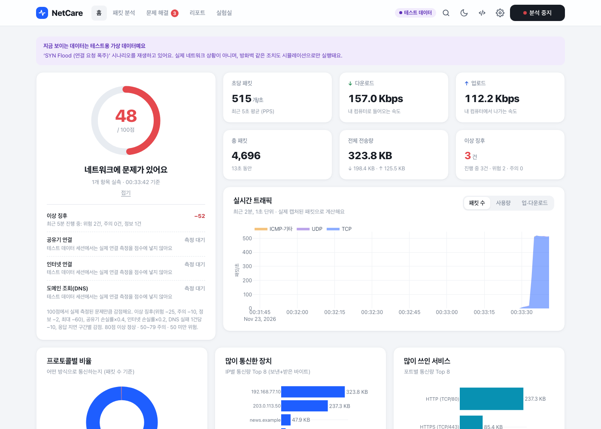
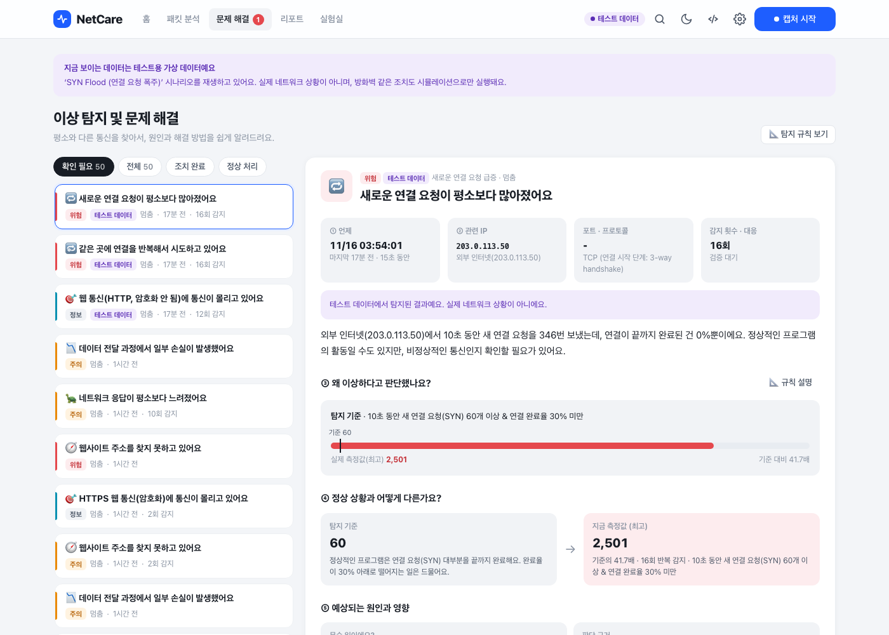
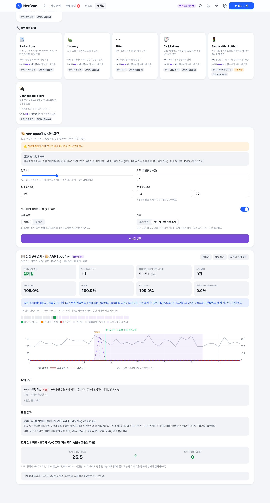
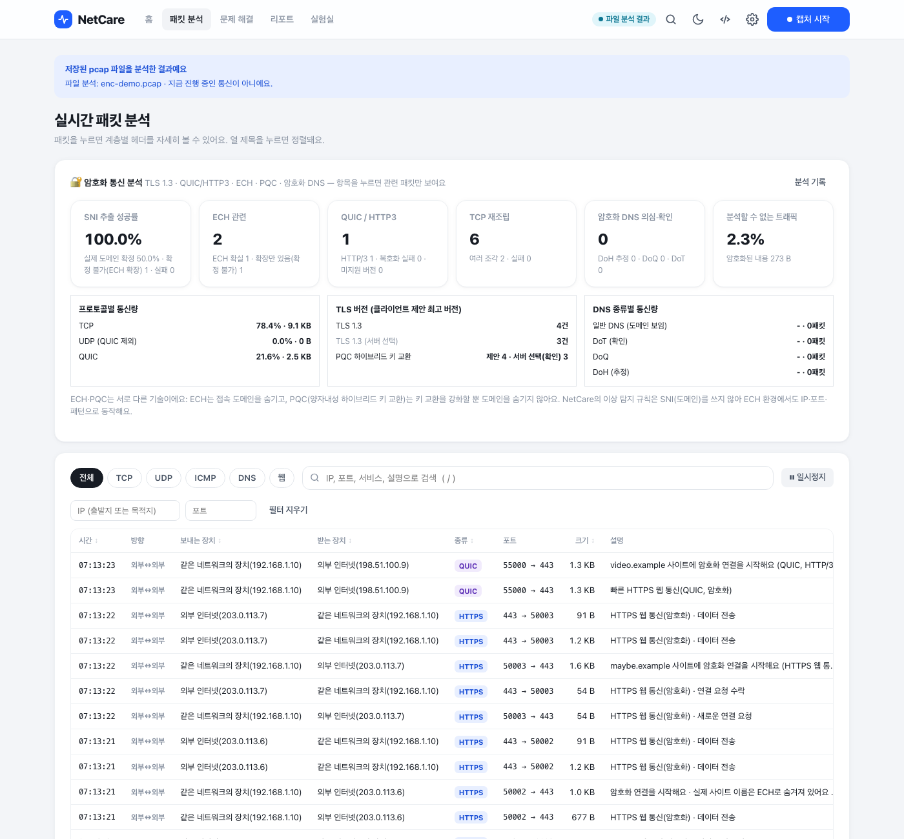
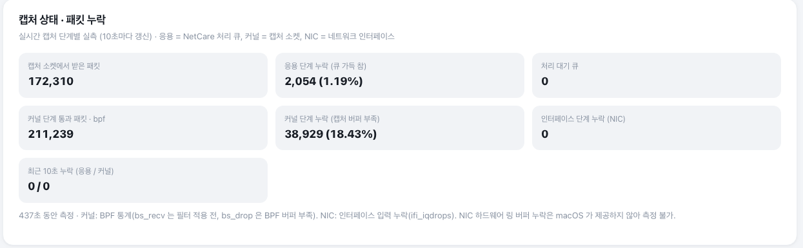
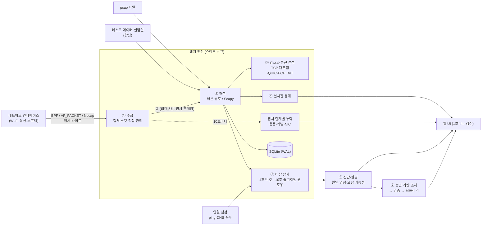
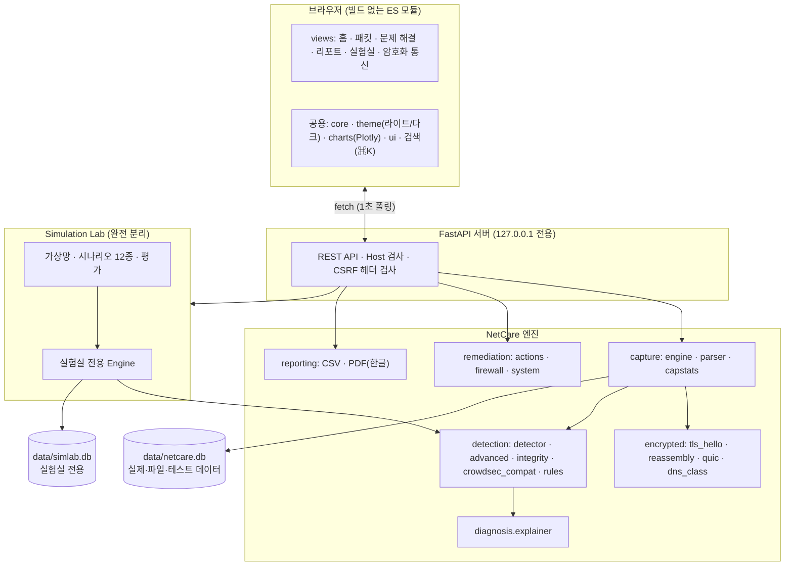
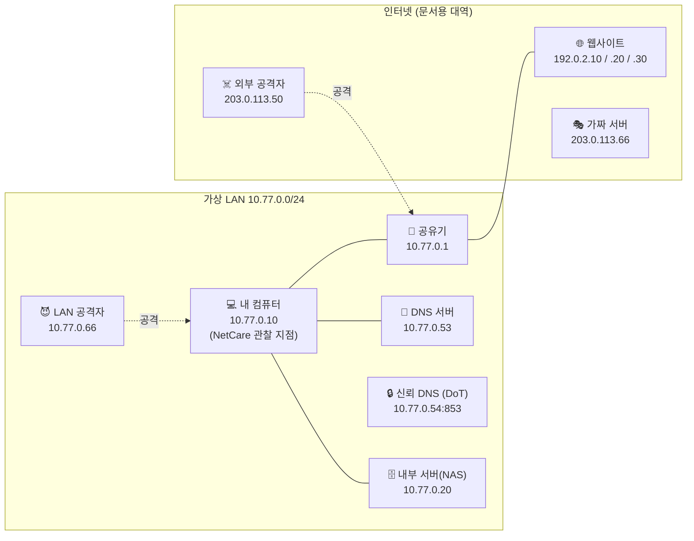
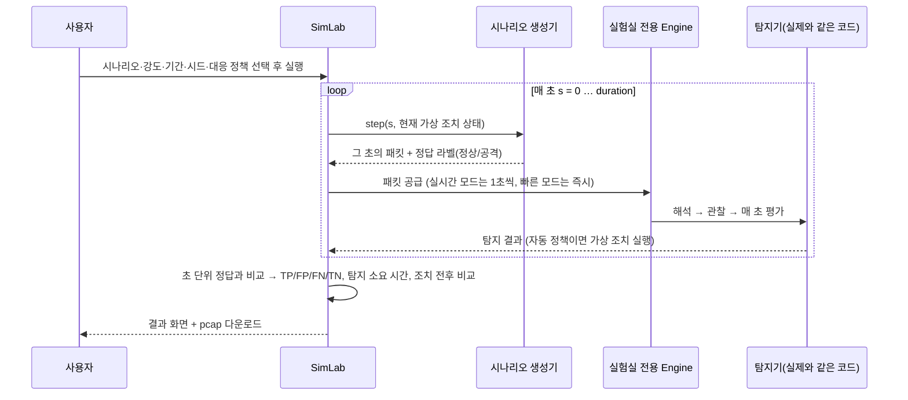

# NetCare

**초보자 친화형 실시간 네트워크 패킷 분석 및 자동 문제 해결 시스템**
Beginner-Friendly Real-Time Network Monitoring and Automated Troubleshooting System

[](https://github.com/tjrdls/202602CN/actions/workflows/netcare-ci.yml)
[](https://github.com/tjrdls/202602CN/actions/workflows/netcare-docker.yml)

NetCare는 Wireshark 수준의 패킷 분석을 누구나 이해할 수 있는 화면으로 보여 줍니다. 문제가 생기면 다음 단계를 차례로 이어 줍니다.

> **탐지 → 원인 설명 → 해결 방법 추천 → 사용자 승인 후 조치 → 효과 검증 → 되돌리기**

함께 들어 있는 기능은 다음과 같습니다.
- **최신 암호화 통신 분석**: TLS 1.3, QUIC/HTTP3, ECH, 양자내성(PQC) 키 교환, DoT·DoQ·DoH
- **패킷 무결성 탐지**: 체크섬 변조, TCP 주입, UDP 재전송
- **CrowdSec과 같은 조건의 웹·무차별 대입 탐지**
- **가상 공격 실험실**: 실제 네트워크를 건드리지 않고 공격·장애를 재현해 탐지 성능을 측정

| 홈 (라이트) | 홈 (다크) |
|---|---|
|  |  |

| 문제 해결 | 가상 공격 실험실 |
|---|---|
|  |  |

| 암호화 통신 분석 | 캡처 상태 · 패킷 누락 (단계별 실측) |
|---|---|
|  |  |

> 위 화면 중 '캡처 상태' 카드만 실제 캡처 화면이고(숫자만 표시), 나머지는 모두 **테스트·합성 데이터**로 찍었습니다. 이 카드는 진단 기능을 켜고 고속 유입을 겪은 중간 버전의 화면이라 누락 수치가 큽니다.

---

## 한눈에 보는 검증 결과

모든 수치는 실제로 실행한 시험 결과입니다. **합성(우리가 만든 데이터)** 과 **실측·공개 데이터셋** 을 구분해 적었습니다. 시험하지 못한 항목은 [9. 검증 결과](#9-검증-결과)의 "미검증"에 따로 모았습니다.

| 분야 | 결과 | 근거 |
|---|---|---|
| 공개 데이터셋 (CSE-CIC-IDS2018) | 라벨된 공격 8건 중 **7건 탐지**(SSH 무차별 대입, 웹 로그인 무차별 대입·XSS·SQL 인젝션 각 2일). FTP는 데이터셋의 FTP 포트가 닫혀 있어 탐지 대상이 아님. 같은 데이터에서 실제 CrowdSec은 웹 공격 0건 | [docs/benchmark/cse-cic-ids2018.md](docs/benchmark/cse-cic-ids2018.md) |
| 가상 실험실 (합성, 156회) | Precision **100%** · Recall 67.0% · F1 80.2% · FPR **0%**. 강도 1배만 보면 Recall 82.8% · F1 90.6% | [docs/08](docs/08_종합_검증_보고서.md) |
| 실측 오탐 (같은 트래픽, 수정 전후 동시 1시간) | 보안 알림 Wi-Fi **7건 → 0건**, 유선 **5건 → 0건**. 모두 원시 패킷으로 확인한 오탐(로드밸런서 RST, 클라우드 서버 연결별 TTL) | [docs/09](docs/09_안정성_신뢰성_개선_보고서.md) |
| 6시간 연속 실측 (유선, 최종 코드) | 848만 개 처리, 응용 단계 누락 **0**, 메모리 증가 없음(끝 **95.7MB**), 커널 누락 1.13%(iCloud 동기화로 보이는 대용량 다운로드 구간에만 몰림 → 원인 확정·해결). 보안 알림 4건은 IPv6 `::` 오탐으로 확인 → 수정 | [docs/09](docs/09_안정성_신뢰성_개선_보고서.md) |
| macOS 유선 순간 유입 커널 누락 해결 | 같은 트래픽 30분 동시 캡처(다운로드 249회, 평균 197Mbps): 커널 누락 6,463 → **0**. BPF를 수신 전용 프로세스가 읽어 처리 스레드와 GIL을 나눠 쓰지 않음 | [분석](docs/benchmark/stability/macos_drop_analysis/README.md) |
| 처리 성능 (실측 패킷) | 엔진 처리량 초당 약 6,600개 → **24,000~27,000개** (빠른 해석 경로). 루프백 유입 초당 6만 개까지 누락 0 | [docs/09](docs/09_안정성_신뢰성_개선_보고서.md) |
| 장시간 메모리 (가속 시뮬레이션) | 6시간 분량 96.6MB → **37.4MB**. 12시간 분량에서도 약 44MB에서 멈춤 | [docs/09](docs/09_안정성_신뢰성_개선_보고서.md) |
| 고속 유입 메모리 (실측) | 처리 큐가 가득 찰 때 RSS 최대 1,272MB → **308MB**. 큐 5만 개 기준 275.6MB → 20.5MB | [docs/09](docs/09_안정성_신뢰성_개선_보고서.md) |
| 암호화 통신 (실측) | Cloudflare trace 정답과 10개 사례 일치. 공개 리졸버 3곳 DoT 실측 모두 'DoT·확인됨' | [docs/07](docs/07_암호화통신_분석.md) · [docs/09](docs/09_안정성_신뢰성_개선_보고서.md) |
| 테스트 | 단위·통합 테스트 **170개** 통과. GitHub Actions에서 Ubuntu·Windows·macOS 테스트, Linux 실제 캡처, Windows 실행 파일 빌드·실행 | [11. 테스트와 CI](#11-테스트와-ci) |

---

## 목차
1. [빠른 시작](#1-빠른-시작)
2. [동작 원리](#2-동작-원리)
3. [시스템 구성](#3-시스템-구성)
4. [이상 탐지 규칙 28종](#4-이상-탐지-규칙-28종)
5. [최신 암호화 통신 분석](#5-최신-암호화-통신-분석)
6. [진단 · 조치 · 상태 점수](#6-진단--조치--상태-점수)
7. [가상 공격 실험실 (Simulation Lab)](#7-가상-공격-실험실-simulation-lab)
8. [CrowdSec 비교](#8-crowdsec-비교)
9. [검증 결과](#9-검증-결과)
10. [안전장치](#10-안전장치)
11. [테스트와 CI](#11-테스트와-ci)
12. [폴더 구조](#12-폴더-구조)
13. [한계](#13-한계)
14. [문서](#14-문서)

---

## 1. 빠른 시작

### 방법 A. 도커로 실행 (권장 · 설치할 것은 Docker 하나)

파이썬, 라이브러리, 캡처 도구, 한글 글꼴이 모두 들어 있는 이미지를 받아 바로 실행합니다. `main`에 올라온 코드는 GitHub Actions가 테스트를 통과시킨 뒤 이미지(amd64·arm64)를 자동으로 만들어 배포합니다.

```bash
docker run -d --name netcare -p 127.0.0.1:8765:8765 -v netcare-data:/data ghcr.io/tjrdls/netcare:latest
# 브라우저에서 http://127.0.0.1:8765
docker logs -f netcare        # 로그 보기
docker rm -f netcare          # 종료 (기록은 netcare-data 볼륨에 남음)
```

**Linux에서 이 컴퓨터의 실제 인터페이스를 캡처하려면** 호스트 네트워크와 캡처 권한을 줍니다.

```bash
docker run -d --name netcare --network host --cap-add NET_RAW --cap-add NET_ADMIN \
  -e NETCARE_HOST=127.0.0.1 -v netcare-data:/data ghcr.io/tjrdls/netcare:latest
```

저장소를 받았다면 다음 명령으로도 실행할 수 있습니다.
- 기본: `docker compose up -d`
- Linux 실제 캡처: `docker compose --profile host-capture up -d netcare-host`
- 이미지 직접 만들기: `docker build -t netcare .`

| 실행 환경 | 되는 것 | 안 되는 것 |
|---|---|---|
| Linux + `--network host` | 모든 기능 (실제 인터페이스 실시간 캡처 포함) | 방화벽 차단 조치 (컨테이너가 호스트 방화벽을 바꾸지 않도록 꺼 둠) |
| macOS·Windows (Docker Desktop) | 파일 분석, 테스트 데이터, 실험실, 리포트 | 이 컴퓨터의 Wi-Fi·유선 실시간 캡처 (Docker가 가상 머신 안에서 돌기 때문) → 방법 C 사용 |

- 포트는 반드시 `127.0.0.1:8765:8765`처럼 **127.0.0.1에만** 공개하세요. `-p 8765:8765`로 열면 같은 네트워크의 다른 기기가 접근할 수 있습니다.

### 방법 B. Windows 실행 파일 (파이썬 설치 불필요)

GitHub Actions가 Windows에서 빌드와 실행 점검을 통과한 `NetCare.exe`를 자동으로 만듭니다.
- **받는 곳**: **Actions → NetCare CI → 최근 실행 → Artifacts → NetCare-windows-x64**. `netcare-v*` 태그를 붙인 버전은 **Releases**에서 받습니다.

1. 실시간 캡처를 쓰려면 [Npcap](https://npcap.com)을 먼저 설치합니다(라이선스상 함께 배포할 수 없음). 설치하지 않아도 파일 분석·테스트 데이터·실험실은 동작합니다.
2. `NetCare.exe`를 실행하면 브라우저에서 `http://127.0.0.1:8765`가 열립니다. 방화벽 조치까지 쓰려면 "관리자 권한으로 실행"합니다.
3. 기록은 `%LOCALAPPDATA%\NetCare`에 저장됩니다.

### 방법 C. 파이썬으로 직접 실행 (macOS·Windows 실시간 캡처, 개발용)

Python 3.10 이상이 필요합니다.

```bash
git clone https://github.com/tjrdls/202602CN.git
cd 202602CN/NetCare
python3 -m venv .venv
.venv/bin/pip install -r requirements.txt     # Windows: .venv\Scripts\pip install -r requirements.txt
.venv/bin/python run.py                       # http://127.0.0.1:8765 이 브라우저에서 자동으로 열림
```

| OS | 실시간 캡처 준비 |
|---|---|
| macOS | `/dev/bpf*` 읽기 권한이 필요합니다. Wireshark의 ChmodBPF를 설치했다면 sudo 없이 캡처되고, 아니면 `sudo .venv/bin/python run.py`로 실행합니다 |
| Linux | `sudo`로 실행하거나 `sudo setcap cap_net_raw,cap_net_admin=eip $(readlink -f .venv/bin/python)` |
| Windows | [Npcap](https://npcap.com) 설치 후 "관리자 권한으로 실행"한 명령 프롬프트에서 실행 |

- **캡처 시작:** 오른쪽 위 **캡처 시작** → **실시간 캡처** → "추천" 인터페이스를 고르면 수집이 시작됩니다.
- **권한이 없을 때:** **파일 분석**(pcap/pcapng), **테스트 데이터**, **실험실**로 모든 화면을 체험할 수 있습니다.
- **기록을 따로 두고 싶을 때:** `NETCARE_DATA_DIR=/tmp/netcare-demo .venv/bin/python run.py --port 8780`처럼 실행합니다.
- **접속 범위:** 서버는 `127.0.0.1`에만 열려, 같은 네트워크의 다른 기기에서는 접속할 수 없습니다.

---

## 2. 동작 원리

NetCare는 패킷 하나하나를 **수집 → 해석 → 저장·집계 → 탐지 → 진단 → (승인 시) 조치 → 검증** 하는 파이프라인입니다.



### ① 수집 (Capture)
- **캡처 소켓을 직접 엽니다.** NetCare가 OS 캡처 소켓(macOS BPF, Linux AF_PACKET, Windows Npcap)을 직접 열어 Scapy `AsyncSniffer`에 넘깁니다. 그래서 커널 단계 통계를 읽을 수 있습니다.
- **스니퍼는 해석하지 않습니다.** 원시 바이트만 크기가 정해진 큐에 넣습니다. 예전에는 Scapy 객체를 큐에 넣어서, 큐가 가득 차면 메모리가 수백 MB씩 늘었습니다.
- **커널 캡처 버퍼를 키웁니다.** macOS BPF는 512KB(Scapy 기본 64KB), Linux 수신 버퍼는 8MB를 요청합니다(Scapy 기본 64KB). 짧은 순간 유입에서도 커널 단계 누락이 생기던 문제를 줄였습니다.
- **macOS는 수신 전용 프로세스가 BPF를 읽습니다.** 처리 스레드와 파이썬 GIL을 나눠 쓰지 않아, 유선 1Gbps 순간 유입에서도 512KB 커널 버퍼를 바로 비웁니다. 엔진이 늦으면 데이터는 그 프로세스 메모리(상한 256MB)에서 기다리고, 넘친 몫은 응용 단계 누락으로 셉니다(`NETCARE_BPF_PUMP=0`이면 기존 방식).
- **누락을 단계별로 셉니다.** 10초마다 세 단계로 나눠 기록합니다. OS가 주지 않는 값은 '측정 불가'로 표시합니다. 결과는 대시보드 **캡처 상태 · 패킷 누락** 카드와 `GET /api/capture/stats`에서 볼 수 있습니다.

  | 단계 | 무엇을 세나 |
  |---|---|
  | 응용 | NetCare 큐가 가득 차 버린 패킷 |
  | 커널 | BPF `BIOCGSTATS` / AF_PACKET `PACKET_STATISTICS` / Npcap `pcap_stats` |
  | NIC | 인터페이스 입력 누락 |

- **인터페이스가 사라지면 멈춥니다.** 랜선·USB 어댑터를 분리해 인터페이스가 사라지면 20초 안에 캡처를 멈추고 알립니다. 예전에는 CPU 100%로 헛돌면서 화면은 계속 '캡처 중'으로 보였습니다.
- **캡처 필터는 미리 검사합니다.** BPF 캡처 필터(예: `tcp port 443`)는 시작 전에 문법을 검사합니다.
- **무차별 모드는 자동으로 대체합니다.** 무차별(promiscuous) 모드를 거부하는 Wi-Fi는 자동으로 일반 모드로 다시 시도합니다.

### ② 해석 (Parsing)
- **두 가지 경로로 해석합니다.**
  - **빠른 경로:** 흔한 Ethernet(또는 macOS 루프백) + IPv4/IPv6 + TCP/UDP/IGMP 프레임은 고정 위치 헤더를 직접 읽습니다(`parser.fast_record`).
  - **Scapy 경로:** Scapy 해석이 결과를 바꿀 수 있는 패킷은 Scapy로 해석합니다. DNS·터널처럼 상위 계층이 붙는 포트, IP 조각, VLAN, IPv6 확장 헤더, ICMP·ARP가 여기에 해당합니다. 상위 계층이 붙는 포트는 Scapy 설정을 실행 중에 확인해 판단합니다.
  - **결과가 같음을 확인했습니다.** 실측·공개 데이터셋 패킷 **1,410,358개**를 두 경로로 해석해 레코드의 모든 필드를 대조했고 불일치는 0입니다. Linux 실제 패킷으로도 확인했습니다. 실측 패킷 처리량은 약 4배가 됐습니다.
- **읽는 필드**
  - TCP: 플래그, SEQ/ACK, 윈도우
  - IP: TTL, 주소
  - DNS: 질의 ID·이름·응답 코드·답변
  - HTTP(평문): 요청 줄·Host·User-Agent·응답 코드
  - FTP: 응답 코드
  - RTP: 순서 번호
  - 수신 패킷: 체크섬 검사
- **HTTPS 본문은 복호화하지 않으며 볼 수 없습니다.** 암호화 통신에서 읽는 정보는 [5장](#5-최신-암호화-통신-분석)에 정리했습니다.
- 각 필드에 한국어 설명을 붙이고(`analysis/terms.py`), 화면용 쉬운 문장을 만듭니다. 예: "github.com 사이트에 암호화 연결을 시작해요".

### ③ 저장과 실시간 통계
- 처리 스레드는 패킷을 최대 500개(또는 0.3초)씩 묶어 SQLite에 저장합니다. WAL 모드라 화면 조회와 쓰기가 서로 막지 않습니다.
- 보존 한도(기본 30만 패킷)를 넘으면 오래된 패킷부터 지웁니다. 탐지 결과와 조치 기록은 따로 보존합니다.
- PPS, 업·다운로드 속도, 프로토콜·IP·포트별 순위를 메모리에서 바로 집계합니다. 장시간 실행에 대비해 IP·포트별 누적 키에는 상한(2만)을 둡니다. 상한을 넘으면 적게 통신한 쪽부터 지우고, 장치 수는 "약 N"으로 표시합니다.

### ④ 이상 탐지 (Detection)
- **판단 단위:** 패킷을 **1초 단위 버킷**에 요약하고, 매 초 **최근 10초 슬라이딩 윈도우**로 규칙을 평가합니다.
- **규칙 기반:** "10초 안에 순수 SYN 60개 이상 + 핸드셰이크 완료율 낮음"처럼 근거가 분명한 조건을 씁니다.
- **통계 기반:** 트래픽 급증은 평소 사용량을 **EWMA(지수가중이동평균)** 로 학습한 뒤 **z-score**가 기준을 넘을 때만 판단합니다.
- **증거 결합:** TTL 같은 약한 지표는 단독으로 알림을 만들지 않습니다. 연결 상태(SEQ·ACK·FIN)와 어긋날 때만 징후로 셉니다([4장](#4-이상-탐지-규칙-28종)).
- **확실성 구분:** 패킷만으로 확정할 수 없는 공격(IP·DNS 스푸핑, TCP 주입 등)은 반드시 **'의심'** 으로 표시하고 심각도를 낮게 제한합니다.
- **상태 정리:** 장시간 실행에 대비해 탐지기가 기억하는 연결·질의 상태는 시간이 지나면 지우고, 트래픽이 멈춰도 정리를 계속합니다. 예전에는 일부 상태가 상한에 닿으면 새 항목을 받지 않아 DNS 위조 탐지가 조용히 멈추는 버그가 있었습니다.

### ⑤ 진단·설명 (Diagnosis)
`diagnosis/explainer.py`가 탐지 결과를 **무엇이 / 누가 / 어떤 프로토콜로 / 왜 문제인지 / 어떤 영향이 있는지 / 오탐일 가능성** 으로 풀어 씁니다. 그 문제에 **관련 있는 조치만** 추천하고, 탐지 방식과 한계·분석 상태(확인됨/추정됨/분석 제한)도 함께 보여 줍니다. 모두 규칙 기반이라 AI나 외부 서비스 없이 동작합니다.

### ⑥ 조치 → 검증 → 되돌리기 (Remediation)
1. **미리보기**: 실행할 명령, 영향, 부작용, 필요한 권한을 먼저 보여 줍니다.
2. **승인**: 시스템을 바꾸는 조치는 "이해했어요" 체크와 확인이 모두 있어야 실행됩니다(API도 `confirm` + `acknowledge_risk`를 검사).
3. **실행**: 연결 점검, DNS 테스트, DNS 캐시 초기화, 통신 내역 확인, 프로세스 찾기, 방화벽 IP 차단.
4. **효과 검증**: 조치 후 같은 지표를 다시 측정해 실제로 좋아졌는지 보여 줍니다.
5. **되돌리기**: 실행 전 상태를 기록해 두고, NetCare가 만든 규칙만 정확히 지웁니다.

---

## 3. 시스템 구성



### 모듈별 역할

| 계층 | 모듈 | 역할 |
|---|---|---|
| 진입점 | `run.py` | 인자 처리(`--port`, `--no-browser`), 서버 실행, 브라우저 열기 |
| 설정 | `netcare/config.py` | 탐지 임계값·보존 한도·점검 주기. `data/config.json`에 저장하며 값 범위를 검증 |
| 수집 | `netcare/capture/` | `interfaces.py`(목록·추천·Windows 이름 변환), `engine.py`(스레드·큐·세션), `parser.py`(빠른 경로 + Scapy 해석), `capstats.py`(캡처 소켓·커널/NIC 통계·버퍼) |
| 암호화 분석 | `netcare/encrypted/` | `tls_hello.py`(ClientHello/ServerHello·ECH·PQC), `reassembly.py`(TCP 재조립), `quic.py`(QUIC Initial 복호화), `dns_class.py`(DNS·DoT·DoQ·DoH), `analyzer.py` |
| 분석 | `netcare/analysis/` | `stats.py`(실시간 통계), `probe.py`(ping·DNS 실측), `health.py`(상태 점수), `terms.py`(용어 번역) |
| 탐지 | `netcare/detection/` | `detector.py`(기본 규칙 + EWMA), `advanced.py`(스푸핑·품질·확장), `integrity.py`(체크섬·TCP 주입·UDP 재전송), `crowdsec_compat.py`(CrowdSec 동등 시나리오), `rules.py`(규칙 카탈로그) |
| 진단 | `netcare/diagnosis/explainer.py` | 원인·영향·오탐 가능성 설명, 관련 조치 추천 |
| 조치 | `netcare/remediation/` | `actions.py`(승인·검증·롤백), `firewall.py`(OS별 방화벽), `system.py`(권한·명령 실행) |
| 저장 | `netcare/storage/db.py` | SQLite(WAL), 필터·정렬·페이지 조회, 리포트 쿼리, 캡처 통계 기록 |
| 리포트 | `netcare/reporting/export.py` | CSV 5종, 한글 PDF |
| 진단 도구 | `netcare/diagnostics.py` | 메모리 진단(RSS·tracemalloc·자료구조 크기). 읽기 전용 |
| 테스트 데이터 | `netcare/testdata/synthetic.py` | 합성 시나리오 5종 (`[테스트 데이터]` 배지로 구분) |
| 실험실 | `netcare/simlab/` | `network.py`(가상망), `scenarios.py`(시나리오 12종), `evaluate.py`(지표), `lab.py`(실험 관리) |
| API | `netcare/api/server.py` | REST API + 정적 파일 |
| UI | `netcare/web/` | `css/`(디자인 토큰·컴포넌트), `js/`(ES 모듈, 빌드 불필요) |

### 스레드 구조
| 스레드 | 하는 일 |
|---|---|
| 캡처(AsyncSniffer) | 캡처 소켓에서 원시 프레임을 받아 큐에 넣기만 함 (가장 가볍게) |
| `netcare-processor` | 큐에서 꺼내 해석 → 암호화 분석 → 통계 → 탐지기 관찰 → 묶음 저장 |
| `netcare-ticker` | 매 초 탐지 평가·경보 갱신, 10초마다 캡처 단계별 통계 기록·인터페이스 상태 확인 |
| `netcare-prober` | 주기적으로 공유기·인터넷 ping, DNS 조회 실측 |
| `netcare-pcap` / `-test` / `-simlab` | 파일·테스트·실험실 패킷을 같은 처리 경로로 공급 |

캡처와 처리를 분리했기 때문에 트래픽이 몰려도 캡처가 막히지 않습니다. 처리가 따라가지 못하면 버린 패킷 수가 단계별로 정직하게 표시됩니다.

### 데이터 출처 구분
모든 세션에는 출처가 붙습니다: **실시간 캡처(live) / pcap 파일(pcap) / 테스트 데이터(test) / 실험실(sim)**.
화면은 항상 출처 배지를 보여 주고, 리포트는 기본으로 **실제 캡처만** 집계합니다. 실험실 데이터는 아예 다른 DB 파일에 저장됩니다.

### 주요 API
| 분류 | 엔드포인트 |
|---|---|
| 캡처 | `GET /api/interfaces`, `POST /api/capture/start·stop·import`, `POST /api/test/run`, `GET /api/capture/stats`(응용·커널·NIC 누락, `?session_id=`로 지난 기록) |
| 화면 데이터 | `GET /api/dashboard`, `/api/stats`, `/api/packets`(ip·port·tag·정렬·페이지), `/api/packets/{id}`, `/api/ip/{ip}`, `/api/search` |
| 암호화 통신 | `GET /api/encrypted`, `/api/encrypted/events` |
| 탐지·규칙 | `GET /api/anomalies`, `/api/anomalies/{id}`, `/api/rules`, `/api/rules/{type}` |
| 조치 | `GET /api/actions/catalog`, `POST /api/actions/preview·execute`, `POST /api/actions/{id}/verify·rollback` |
| 리포트 | `GET /api/report`, `/api/export/{kind}.csv`, `/api/export/report.pdf` |
| 실험실 | `GET /api/lab/scenarios`, `POST /api/lab/run·stop·pause`, `/api/lab/experiments`, `/api/lab/benchmark` |
| 진단 | `GET /api/diag/memory` (읽기 전용. `NETCARE_TRACEMALLOC=1`로 시작하면 할당 위치까지) |

변경 요청(POST 등)에는 `X-NetCare: 1` 헤더가 필요합니다.

---

## 4. 이상 탐지 규칙 28종

화면의 **문제 해결 → 📐 탐지 규칙 보기**에서 각 규칙의 조건(현재 임계값 반영), 근거, 오탐 가능성, 한계를 볼 수 있습니다.

| # | 규칙 | 분류 | 근거 | 심각도 | 확실성 |
|---|---|---|---|---|---|
| 1 | 특정 장치의 과도한 패킷 | 사용량 | 패킷 | 정보~위험 | 측정 |
| 2 | SYN Flood (새 연결 요청 급증) | 공격 | 패킷 | 주의~위험 | 측정 |
| 3 | 특정 포트 집중 | 사용량 | 패킷 | 정보~주의 | 측정 |
| 4 | 네트워크 사용량 급증 | 사용량 | 통계(EWMA z-score) | 정보~주의 | 측정 |
| 5 | 반복되는 연결 시도 | 공격 | 패킷 | 주의~위험 | 측정 |
| 6 | 포트 스캔 | 공격 | 패킷 | 주의~위험 | 측정 |
| 7 | 특정 장치와의 과도한 통신 | 사용량 | 패킷 | 정보 | 측정 |
| 8 | DNS 조회 실패 | DNS | 패킷 | 주의~위험 | 측정 |
| 9 | 공유기(게이트웨이) 연결 끊김 | 품질 | ping 실측 | 위험 | 측정 |
| 10 | 데이터 손실 (ping) | 품질 | ping 실측 | 주의~위험 | 측정 |
| 11 | 네트워크 지연 (ping) | 품질 | ping 실측 | 주의 | 측정 |
| 12 | ARP 스푸핑 | 스푸핑 | 패킷 | 주의(게이트웨이 사칭이면 위험) | 가능성 높음 |
| 13 | IP 스푸핑(출발지 위조) | 스푸핑 | 패킷 | 최대 주의 | **의심** |
| 14 | DNS 응답 위조 | 스푸핑 | 패킷 | 최대 주의 | **의심** |
| 15 | 지연 증가 (패킷 기반 RTT) | 품질 | 패킷 | 주의 | 측정 |
| 16 | 지터(지연 불규칙) | 품질 | 패킷 | 주의 | 측정 |
| 17 | 데이터 손실 (TCP 재전송) | 품질 | 패킷 | 주의~위험 | 측정 |
| 18 | 서버 연결 중단 | 품질 | 패킷 | 주의~위험 | 측정 |
| 19 | 대역폭 제한 | 품질 | 패킷 | 정보 | **의심** |
| 20 | 비정상 패킷 크기 (큰 ICMP·DNS) | 공격 | 패킷 | 정보 | **의심** |
| 21 | 프로토콜 비율 이상 | 사용량 | 통계(학습 기준선) | 정보 | **의심** |
| 22 | 존재하지 않는 도메인(NXDOMAIN) 조회 급증 | DNS | 패킷 | 정보 | **의심** |
| 23 | 체크섬 오류 (비트 변조·손상 패킷) | 패킷 무결성 | 패킷 | 정보~주의 | **의심** |
| 24 | TCP 주입 (RST·데이터) | 패킷 무결성 | 패킷 | 주의 | **의심** |
| 25 | UDP 재전송(리플레이)·순서 번호 중복 | 패킷 무결성 | 패킷 | 주의 | **의심** |
| 26 | 웹 공격 시도 (민감 파일·경로 조작·SQL 인젝션·XSS·백도어·Log4Shell 등) | 공격 | 평문 HTTP | 주의~위험 | 측정 (시도 여부) |
| 27 | 웹 탐색·크롤링·공격 도구 User-Agent | 공격 | 평문 HTTP | 정보~주의 | 측정 |
| 28 | 로그인 무차별 대입 (FTP·SSH·웹 로그인) | 공격 | 패킷 | 주의 | 가능성 높음 (SSH는 의심) |

### 판단 방식 (주요 규칙)
- **SYN Flood**: 10초 안의 순수 SYN이 임계값(기본 60)을 넘고 그 연결들의 핸드셰이크 완료율이 낮을 때 판단합니다. 완료율 0%에 출발지가 분산돼 있으면 '위험'입니다.
- **포트 스캔**: 한 출발지가 10초 안에 서로 다른 목적지:포트 40곳 이상을 두드리고, 대부분 RST이거나 응답이 없을 때입니다.
- **ARP 스푸핑**: 내 서브넷 안의 같은 IP를 서로 다른 MAC이 주장할 때입니다. 공유기 IP를 사칭하면 '위험'입니다.
- **IP 스푸핑**: 다음 징후가 10초에 5개 이상 모이면 '의심'으로 알립니다.
  - **강한 징후**
    - 내 주소를 쓰는 외부 프레임
    - 예약 주소 출발지
    - LAN 장치의 MAC 불일치
    - 요청하지 않은 SYN-ACK(백스캐터)
    - **같은 연결 안에서 TTL이 바뀌고 SEQ·ACK도 연결 상태와 맞지 않는 패킷**
  - **약한 징후:** 연결 안에서 TTL만 바뀐 경우는 보조 지표라서, 강한 징후가 함께 있을 때만 셉니다.
  - **새 연결은 따로 봅니다.** 연결마다 TTL이 다른 것은 클라우드·CDN에서 흔해서 징후가 아닙니다(실측: Google Cloud, GitHub).
- **TCP 주입**: 연결 상태(SEQ·ACK·FIN)를 추적해, 상태와 어긋난 패킷만 징후로 셉니다.
  - **징후로 세는 것**
    - 예상 SEQ에서 크게 벗어난 RST
    - 보낸 적 없는 위치를 ACK한 RST
    - TTL이 다르면서 SEQ가 정확하지 않은 RST
    - 정확한 SEQ의 RST 직후에 같은 쪽 데이터가 계속 오거나, SEQ가 다른 RST가 반복되는 경우
    - RST 뒤 데이터, 이미 받은 위치와 겹치는 TTL 다른 데이터
  - **세지 않는 것:** 상대가 FIN을 보낸 뒤 정확한 SEQ로 오는 RST는 정상 종료입니다. 로드밸런서처럼 TTL이 달라도 마찬가지입니다.
- **DNS 응답 위조**: 같은 질의 ID에 서로 다른 답이 두 번 오는 경합을 봅니다(먼저 온 쪽이 가짜일 수 있음). 처음부터 위조 응답 하나만 오면 구분할 수 없어 '의심'까지만 판정합니다.
- **체크섬 오류**: 수신 패킷의 IP·TCP·UDP·ICMP 체크섬을 다시 계산해 맞지 않으면 의심합니다. 내가 보낸 패킷은 NIC 체크섬 오프로드 때문에 검사하지 않습니다.
- **UDP 재전송**: RTP(음성·영상 통화)는 자동으로 읽습니다. 자체 UDP 프로토콜은 설정 `udp_seq_ports`로 순서 번호 위치를 알려 줍니다. 예: `"9999:0:4"`는 9999번 포트, 페이로드 0바이트 위치의 4바이트입니다. 같은 번호가 다시 오면 재전송으로 의심합니다. 방송·멀티캐스트 탐색 패킷은 제외합니다.

---

## 5. 최신 암호화 통신 분석

NetCare는 암호화된 내용을 **복호화하지 않습니다**. 표준상 평문으로 보이는 부분만 읽고, 볼 수 없는 정보는 추측해서 채우지 않습니다. 모든 결과에는 아래 네 가지 상태 중 하나가 붙습니다.

| 상태 | 의미 |
|---|---|
| 확인됨 | 패킷에서 직접 읽음 |
| 추정됨 | 간접 근거 (근거와 신뢰도 함께 표시) |
| 분석 제한 | 프로토콜상 볼 수 없음 (예: ECH로 숨긴 실제 도메인) |
| 분석 실패 | 패킷 누락 등으로 해석하지 못함 (원인 기록) |

| 기능 | 내용 |
|---|---|
| TCP 재조립 | 여러 세그먼트로 나뉜 ClientHello를 SEQ로 복원합니다. 최신 Chrome은 PQC 키 공유 때문에 거의 항상 나눠 보냅니다. 중복·재전송·겹침·누락을 처리하고, 겹친 위치에 다른 내용이 오면 TCP 주입 징후로 넘깁니다 |
| TLS 1.3 · ALPN | `supported_versions`로 실제 버전을, ALPN으로 HTTP/2·HTTP/3를 읽습니다 |
| PQC | 지원 그룹·Key Share·서버 선택 그룹에서 하이브리드 양자내성 키 교환(X25519MLKEM768 등)을 표시합니다. PQC는 키 교환 기술이고 SNI를 숨기지 않으므로 ECH와 구분합니다 |
| QUIC · HTTP/3 | RFC 9001·9369의 공개 키로 QUIC Initial만 복호화해 SNI·ALPN·버전·Connection ID를 읽습니다. 그 이후 내용은 볼 수 없습니다 |
| ECH · ESNI | 바깥 SNI가 ECH 공개 이름(예: `cloudflare-ech.com`)이면 "실제 도메인은 암호화됨(분석 제한)"으로 표시합니다. 브라우저는 ECH를 쓰지 않을 때도 가짜(GREASE) ECH 확장을 붙이므로, 그 밖의 경우에는 "확정할 수 없음"으로만 표시합니다. ECH를 쓴다는 이유만으로 악성으로 판단하지 않습니다 |
| DNS 종류 | 일반 DNS, **DoT(확인)**, **DoQ(확인)**, **DoH(추정, 근거 표시)** 를 구분합니다. TCP/UDP 443을 쓴다는 이유만으로 DoH로 단정하지 않습니다 |
| SNI 없는 탐지 | 28종 탐지 규칙은 모두 SNI(도메인)를 쓰지 않고 IP·포트·플래그·흐름으로 판단합니다. 그래서 ECH로 도메인이 숨겨져도 그대로 동작합니다. IP 주소만으로 특정 사이트·악성 도메인을 단정하지 않습니다(CDN·공유 IP) |

화면: 패킷 분석 화면 위쪽의 **🔐 암호화 통신 분석** 패널. SNI 추출률·ECH·QUIC·재조립·암호화 DNS를 보여 주고, 항목을 누르면 관련 패킷만 보입니다. 문제 해결 화면은 모든 탐지에 "확인됨/추정됨 · 탐지 방식 · 분석할 수 없었던 정보"를 표시합니다.

설계와 실측: [docs/07_암호화통신_분석.md](docs/07_암호화통신_분석.md)

---

## 6. 진단 · 조치 · 상태 점수

### 종합 상태 점수
100점에서 **실측 근거가 있을 때만** 감점합니다. 측정하지 않은 항목은 감점하지 않고, 화면에 감점 근거를 모두 공개합니다.

| 항목 | 근거 | 감점 |
|---|---|---|
| 진행 중 이상 징후 | 최근 5분 탐지 | 위험 25 · 주의 10 · 정보 2 (최대 60) |
| 공유기 연결 | ping 실측 | 손실률×0.4 (최대 40), 평균 지연 100ms↑ 5 / 300ms↑ 15 |
| 인터넷 연결 | ping 실측 | 손실률×0.2 (최대 20), 평균 지연 150ms↑ 5 / 400ms↑ 10 |
| DNS | 실제 조회 | 실패 1건당 10 (최대 20), 평균 500ms↑ 5 |

80점 이상: 정상 · 50~79점: 주의 · 50점 미만: 위험

### 조치 목록
| 조치 | 시스템 변경 | 설명 |
|---|---|---|
| 연결 점검 / DNS 테스트 | 없음 | 공유기·인터넷 ping, 여러 DNS 서버로 조회해 원인 구간을 좁힘 |
| 통신 내역 확인 / 프로세스 찾기 | 없음 | 어떤 프로그램이 그 IP·포트와 통신하는지 확인 |
| DNS 캐시 초기화 | 있음 | 오래된·잘못된 DNS 기록 삭제 |
| 방화벽 IP 차단 | 있음 | macOS pf anchor / Linux iptables comment / Windows 방화벽 규칙. NetCare 전용 규칙만 만들고 지움 (컨테이너 안에서는 꺼짐) |

---

## 7. 가상 공격 실험실 (Simulation Lab)

### 왜 필요한가
실제 네트워크에 공격 패킷을 보내는 것은 위험하고, 대부분 불법입니다. 그런데 탐지 기능이 정말 동작하는지는 공격을 재현해 봐야 알 수 있습니다.

그래서 실험실은 다음과 같이 동작합니다.
1. **메모리 안의 가상 네트워크**에서 공격·장애 패킷을 만듭니다.
2. **실제 탐지 엔진과 같은 코드**로 분석합니다.
3. **정답(언제 공격이 있었는지)** 과 비교해 탐지 성능을 숫자로 측정합니다.

### 안전 분리 원칙
| 원칙 | 구현 |
|---|---|
| 패킷을 네트워크로 보내지 않는다 | `simlab/network.py`는 Scapy 패킷 **객체만** 만들고 `send`/`sendp`/`sr` 같은 전송 함수를 import 하지 않습니다(정적 검사 테스트) |
| 실제 시스템을 바꾸지 않는다 | 실험실 조치는 가상 상태(`Effects`)만 바꿉니다. 실제 방화벽·시스템 명령 모듈을 import 하지 않습니다 |
| 실제 데이터와 섞지 않는다 | 실험실 전용 `Engine` + 전용 DB `data/simlab.db`. 실험 후 실제 DB 행 수가 그대로인지 테스트합니다 |
| 실제 주소를 쓰지 않는다 | 사설 대역 `10.77.0.0/24`와 문서용 예제 대역(`192.0.2.0/24`, `203.0.113.0/24`)만 사용합니다 |
| 결과를 숨기지 않는다 | 모든 화면과 리포트에 **[합성 데이터]** 로 표시합니다 |

### 가상 네트워크 구성



NetCare는 '내 컴퓨터'의 인터페이스를 캡처한다고 가정합니다. 그래서 실제 환경과 같이 **내 컴퓨터에 보이는 패킷만** 탐지에 쓰입니다.

### 시나리오 12종 (+ 정상 기준선)

| 종류 | 시나리오 | 재현 내용 | 기대 탐지 | 가상 조치 |
|---|---|---|---|---|
| 기준선 | 정상 트래픽 | 웹·DNS·스트리밍·내부 서버 접속만 발생 | 없음 (오탐 측정용) | - |
| 공격 | IP Spoofing | 내 주소 도용, LAN 장치 사칭(MAC 불일치), 예약 주소, 요청 없는 SYN-ACK, TTL이 다른 RST | IP 스푸핑 **의심** | 공유기 인그레스 필터링 |
| 공격 | ARP Spoofing | "공유기 IP = 공격자 MAC" 위조 ARP 응답 반복 → 트래픽 가로채기 | ARP 스푸핑 | 정적 ARP |
| 공격 | DNS Spoofing | 진짜 DNS보다 먼저 가짜 IP를 담은 응답 (경합 위조) | DNS 위조 **의심** | 암호화 DNS(DoT) 전환 |
| 공격 | Port Scanning | LAN 공격자가 내 TCP·UDP 포트를 차례로 두드림 | 포트 스캔 | 방화벽 차단 |
| 공격 | SYN Flood | 외부 공격자가 핸드셰이크를 끝맺지 않는 SYN 대량 전송 | SYN 급증 | 방화벽 차단 |
| 공격 | 반복 연결 요청 | 닫힌 원격 데스크톱(3389)에 연결 반복 | 반복 연결 | 방화벽 차단 |
| 장애 | Packet Loss | 데이터 일부 손실 → 재전송·중복 ACK 증가 | TCP 손실 | 진단 + 장애 종료 |
| 장애 | Latency | 모든 응답이 고정적으로 늦게 도착 | 지연 증가 | 진단 + 장애 종료 |
| 장애 | Jitter | 응답 지연이 매번 불규칙 | 지터 | 진단 + 장애 종료 |
| 장애 | DNS Failure | DNS 서버가 SERVFAIL을 주거나 응답 없음 | DNS 실패 | 암호화 DNS 전환 |
| 장애 | Bandwidth Limiting | 회선 속도 제한 + 대기열로 지연 증가 | 대역폭 제한 **의심** | 진단 + 장애 종료 |
| 장애 | Connection Failure | 평소 쓰던 내부 서버가 응답을 멈춤 | 연결 중단 | 진단 + 장애 종료 |

> "장애 주입 종료"는 NetCare가 장애를 고친 것이 아니라 **실험 조건을 바꾼 것**입니다. 화면과 기록에서 NetCare의 해결 기능과 구분해 표시합니다.

### 실험 한 번이 진행되는 방식



- **조절 가능한 조건**: 강도(0.05~5배), 전체 길이(15~180초), 공격 구간(기본 12~32초), 시드, 배경 트래픽 유무.
- **실행 속도**: 빠르게(결과 즉시) / 실시간(1초씩 흘러가며 그래프와 탐지가 나타남, **⏸ 일시정지** 가능).
- **대응 정책**: 조치 없음(결과 화면에서 가상 조치를 직접 실행 가능) / 탐지 시 권장 가상 조치 자동 실행.
- **재현성**: 같은 시나리오·조건·시드면 패킷과 지표가 항상 같습니다(테스트로 검증). 실험마다 pcap을 내려받아 Wireshark로 열어 볼 수 있습니다.

### 평가 방법
1초마다 "그 초에 공격이 있었나(정답)"와 "그 초에 기대한 탐지가 켜져 있었나(예측)"를 비교합니다.

| 판정 | 의미 |
|---|---|
| TP | 공격 구간인데 기대한 유형을 탐지 |
| FN | 공격 구간인데 탐지하지 못함 |
| FP | 정상 구간인데 무언가를 탐지 (공격과 무관한 유형도 FP) |
| TN | 정상 구간이고 아무것도 탐지하지 않음 |

- 지표: **Precision, Recall, F1, FPR**, **탐지 소요 시간**(공격 시작 → 첫 기대 탐지).
- 공격이 끝난 직후 윈도우(10초) 동안 관련 경보가 남아 있어도 FP로 세지 않습니다(슬라이딩 윈도우 특성).
- 조치를 실행한 뒤의 구간은 지표에서 빼고 **조치 전후 비교**(조치 직전 10초 vs 조치 2초 뒤부터 10초)로 따로 봅니다.

### 벤치마크 결과 (합성 데이터)
시나리오 12종 + 정상 기준선을 강도 4단계(0.25·0.5·1·2배) × 시드 3개로 **156회** 실행했습니다. 아래는 강도 1배(39회) 결과입니다. 현재 코드로 다시 측정했고, 안정성 개선 전후 결과가 완전히 같았습니다([docs/benchmark/stability/simlab_eval_after.json](docs/benchmark/stability/simlab_eval_after.json)).

| 시나리오 | 탐지율 | 평균 소요 | Precision | Recall | F1 | FPR |
|---|---|---|---|---|---|---|
| 정상 (기준선) | - | - | - | - | - | **0%** |
| ARP Spoofing | 100% | 1.0초 | 100% | 100% | 100% | 0% |
| DNS Spoofing | 100% | 1.0초 | 100% | 100% | 100% | 0% |
| IP Spoofing | 100% | 2.0초 | 100% | 95% | 97.4% | 0% |
| Port Scanning | 100% | 2.0초 | 100% | 95% | 97.4% | 0% |
| 반복 연결 | 100% | 3.0초 | 100% | 90% | 94.7% | 0% |
| SYN Flood | 100% | 3.0초 | 100% | 90% | 94.7% | 0% |
| Connection Failure | 100% | 2.0초 | 100% | 95% | 97.4% | 0% |
| Latency | 100% | 5.7초 | 100% | 76.7% | 86.8% | 0% |
| DNS Failure | 100% | 7.0초 | 100% | 70% | 82.4% | 0% |
| Packet Loss | 100% | 8.0초 | 100% | 65% | 78.8% | 0% |
| Jitter | 100% | 8.7초 | 100% | 61.7% | 76.3% | 0% |
| Bandwidth (의심) | 100% | 10.0초 | 100% | 55% | 71.0% | 0% |
| **강도 1배 전체** | | | **100%** | **82.8%** | **90.6%** | **0%** |
| **156회 전체** | | | **100%** | **67.0%** | **80.2%** | **0%** |

**결과를 읽을 때 주의할 점**
- **이 숫자는 우리가 만든 합성 시나리오에 대한 결과입니다.** 생성기와 탐지기를 같은 프로젝트에서 만들었으므로 실제 네트워크의 탐지율을 보장하지 않습니다. 성능 근거는 [8장](#8-crowdsec-비교)의 공개 데이터셋 결과입니다.
- Recall이 100%가 아닌 이유는 대부분 **탐지 소요 시간**입니다. 품질 장애는 여러 초의 근거(RTT·재전송)가 모여야 판단하므로 공격 초반 몇 초가 FN이 됩니다. 품질 장애 5종은 강도 1배 미만에서 놓칩니다.

### 실험실 사용법
1. 상단 **실험실** 탭(단축키 `5`)으로 이동합니다.
2. 시나리오 카드를 고릅니다. 카드에 실험 목적과 난이도가 있고, 실행 전에 "실행하면 이렇게 돼요" 안내가 나옵니다.
3. 강도·기간·실행 속도·대응 정책을 정하고 **▶ 실험 실행**을 누릅니다.
4. 결과에서 탐지 소요 시간, P/R/F1/FPR, 초 단위 타임라인, 오탐 목록, 가상 조치 전후 비교를 확인하고 pcap을 내려받습니다.
5. **벤치마크**는 모든 시나리오를 강도·반복 조건별로 한 번에 돌려 표로 정리합니다.

---

## 8. CrowdSec 비교

[CrowdSec](https://www.crowdsec.net)은 웹 서버·sshd·방화벽 **로그**를 읽어 leaky bucket 시나리오로 공격을 찾는 오픈소스 보안 엔진입니다. NetCare는 로그 대신 **패킷**에서 같은 사건을 만들고, CrowdSec과 **같은 조건**으로 판정합니다(`netcare/detection/crowdsec_compat.py`). 같은 조건이란 용량·누수 속도·distinct·blackhole과 Hub 패턴 목록을 말합니다.

| NetCare가 패킷에서 만든 사건 | 같은 조건의 CrowdSec 시나리오 |
|---|---|
| 평문 HTTP 요청의 경로·인자·User-Agent | `http-sensitive-files`, `http-path-traversal-probing`, `http-sqli-probing`, `http-xss-probing`, `http-backdoors-attempts`, `http-bad-user-agent`, `http-crawl-non_statics`, `apache_log4j2_cve-2021-44228`, `http-cve-2021-41773/42013` |
| 평문 HTTP 응답 코드 (요청과 짝지음) | `http-probing`, `http-admin-interface-probing` |
| FTP 응답 530 (로그인 실패) | `vsftpd-bf` |
| SSH 연결 시도 | `ssh-bf` (암호화로 인증 실패를 볼 수 없어 연결 수로 근사 → '의심') |
| 열려 있지 않은 포트로 온 SYN | `iptables-scan-multi_ports` |

패턴 목록은 CrowdSec Hub 데이터를 그대로 씁니다(MIT, `netcare/detection/data/crowdsec/NOTICE.md`).

**NetCare 확장** (CrowdSec에 없는 조건, 근거에 `netcare_extension`으로 표시)
- **URL 디코딩 후 비교:** CrowdSec은 로그에 적힌 그대로(인코딩된 상태) 비교해 `%3Cscript%3E` 같은 인코딩된 공격을 놓칩니다.
- **SQL 인젝션 문법 휴리스틱:** `' and 1=1`, `order by 3`, `union select`, 따옴표 뒤 주석 같은 느린 수동 공격을 잡습니다.
- **웹 로그인 무차별 대입:** 실패 응답이 401/403이 아니라 302·200인 앱도 같은 로그인 경로 POST 반복으로 잡습니다.

### 공개 데이터셋 벤치마크 (CSE-CIC-IDS2018)
GitHub Actions(`.github/workflows/netcare-bench.yml`)가 다음을 자동으로 수행하고, 결과를 [docs/benchmark/cse-cic-ids2018.md](docs/benchmark/cse-cic-ids2018.md)에 기록합니다.

1. [CSE-CIC-IDS2018](https://www.unb.ca/cic/datasets/ids-2018.html) 공개 버킷에서 **공격받은 서버의 캡처만** 받습니다.
2. NetCare가 pcap을 분석합니다(실제 엔진과 같은 코드).
3. 같은 패킷으로 만든 Apache·vsftpd 로그를 **실제 CrowdSec**(time-machine 모드, 중앙 서버 전송 끔)에 넣습니다.
4. 데이터셋 라벨과 비교합니다.

| 날짜 | 공격 (라벨) | NetCare | 첫 탐지까지 | CrowdSec |
|---|---|---|---|---|
| 2018-02-14 | FTP 무차별 대입 | ❌ (반복 연결·SYN 급증만) | - | ❌ |
| 2018-02-14 | SSH 무차별 대입 | ✅ `ssh_bf` | 51초 | 측정 불가 (sshd 로그를 패킷으로 만들 수 없음) |
| 2018-02-22 | 웹 로그인 무차별 대입 | ✅ 확장 | 342초 | ❌ |
| 2018-02-22 | XSS | ✅ 확장 | 47초 | ❌ |
| 2018-02-22 | SQL 인젝션 | ✅ 확장 | 270초 | ❌ |
| 2018-02-23 | 웹 로그인 무차별 대입 | ✅ 확장 | 44초 | ❌ |
| 2018-02-23 | XSS | ✅ 확장 | 12초 | ❌ |
| 2018-02-23 | SQL 인젝션 | ✅ 확장 | 123초 | ❌ |

**공정성 검토와 한계**
- **FTP:** 데이터셋에서 FTP 포트가 닫혀 있어(서버가 모든 SYN에 RST) 로그인 실패 자체가 없습니다. 두 도구 모두 탐지 대상이 아닙니다.
- **웹 공격:** NetCare가 잡은 웹 공격은 모두 **확장 조건**입니다. CrowdSec과 같은 조건(동등 시나리오)만 쓰면 두 도구 결과가 같았습니다.
  - 같은 외부 스캐너를 둘 다 탐지했습니다.
  - 웹 공격일에는 둘 다 0건이었습니다.
- **탐지 시각:** CrowdSec이 기록하는 시각은 첫 사건 시각이고, NetCare는 알림 시각입니다. 기준이 달라 탐지 시간을 직접 비교할 수 없습니다.
- **HTTPS:** CrowdSec은 HTTPS 서버의 로그도 읽지만, NetCare는 HTTPS를 복호화하지 않으므로 HTTPS 웹 공격은 판정하지 못합니다.
- **NetCare만 보는 것:** 로그가 없는 장비·서비스의 공격(스캔, SYN Flood, 스푸핑, 체크섬 변조, TCP 주입)은 패킷만으로 봅니다.

로컬 실행: `pip install remotezip` 후 `python scripts/bench/cse_cic_ids2018.py --case web_thu --out bench-out`

---

## 9. 검증 결과

자세한 내용은 [docs/08_종합_검증_보고서.md](docs/08_종합_검증_보고서.md)(탐지 성능·장시간 캡처·CrowdSec 비교 조건)와 [docs/09_안정성_신뢰성_개선_보고서.md](docs/09_안정성_신뢰성_개선_보고서.md)(메모리·오탐·누락)에 있습니다. 원본 데이터는 `docs/benchmark/`에 있습니다.

### 실측 오탐 (같은 트래픽을 수정 전후 코드로 동시에 캡처)
| 실측 | 수정 전 보안 알림 | 수정 후 보안 알림 | 확인 결과 |
|---|---|---|---|
| 유선 LAN, 33분 | 3 | **0** | 로드밸런서가 FIN 뒤 정확한 SEQ로 보낸 RST (TTL만 다름) |
| Wi-Fi, 1시간 | 7 | **0** | 로드밸런서 RST 6건, GitHub 서버의 연결별 TTL 차이 1건 |
| 유선 LAN, 1시간 (최종 코드) | 5 | **0** | 모두 로드밸런서가 FIN 뒤 정확한 SEQ로 보낸 RST (TTL만 다름) |
| 유선 LAN, 6시간 (최종 코드) | – | 4 → IPv6 수정 후 **0** | LAN 장치가 출발지 `::`로 보낸 IPv6 주소 중복 확인·MLD 보고(표준 동작)를 위조 징후로 셈 → `::`→`ff02::` 허용, 회귀 테스트 추가 |

보안 알림이 아닌 알림(손실·지연·트래픽량 등)은 종류와 건수가 같았습니다. 실측에는 공격이 없으므로, 탐지 유지는 합성 156회와 공개 데이터셋 회귀로 확인했습니다. 두 시험 모두 수정 전과 결과가 완전히 같습니다.

### 메모리와 장시간 실행
| 시험 | 수정 전 | 수정 후 |
|---|---|---|
| 가속 소크 (6시간 분량 흐름 교체) | 96.6MB, 계속 증가 | **37.4MB**, 12시간 분량에서 약 44MB로 멈춤 |
| 세션 반복 생성·종료 (TCP 36,000 · QUIC 9,000 → 정지 15분) | 상태가 그대로 남음 (예: 36,000개) | 시간 만료 대상 모두 **0** |
| 큐가 가득 찼을 때 (실측 패킷 5만 개) | 275.6MB | **20.5MB** |
| 실측 고속 유입 (유선) | RSS 최대 1,272MB, 유입 뒤에도 599MB 이상 | RSS 최대 **308MB** |
| 실측 6시간 연속 (유선, 최종 코드, 848만 개) | – | RSS 182 → **95.7MB** (최대 194.6MB). 95MB 안팎에서 증가 추세 없음 |

찾아낸 원인은 다음과 같습니다.
- 세션 누적 통계에 상한이 없었습니다.
- 탐지기 상태 일부에 시간 만료가 없었고, 상한에 닿으면 새 항목을 받지 않아 탐지가 조용히 멈췄습니다.
- 트래픽이 멈추면 정리 자체가 멈췄습니다.
- 처리 큐에 Scapy 객체를 넣고 있었습니다.

### 처리 성능과 패킷 누락
| 시험 | 결과 |
|---|---|
| 실측 패킷 엔진 처리량 | 초당 약 6,600개 → **24,000~27,000개** |
| 루프백 유입 (macOS, 120B UDP) | 수정 전: 초당 1만 개에서 처리 35%, 커널 누락 발생 → 최종: 초당 **6만 개까지 누락 0**. 초당 10만 개에서 커널 누락 0, 응용 단계 누락 발생 |
| Linux 실제 캡처 (GitHub Actions) | AF_PACKET 통계 확인. 수신 버퍼 확대로 초당 1만 개 커널 누락 67,005 → **0** |
| 같은 트래픽 BPF 버퍼 비교 (Wi-Fi) | 64KB 커널 누락 1,287 → 512KB **0** |
| 유선 1시간 (같은 트래픽, 수정 전후) | 최종 코드 커널 누락 0.02%. 수정 전 코드는 순간 유입에서 패킷의 약 절반을 기록 없이 놓침(같은 10초 처리 3,786 대 7,202개) |
| 유선 6시간 (최종 코드) | 응용 누락 0, 커널 누락 1.13%. 누락은 대용량 다운로드가 이어진 80분(2.49GB, iCloud 동기화로 추정)에만 생겼다. 원인은 수신 스레드의 GIL 경쟁 → 수신 전용 프로세스로 해결 ([분석](docs/benchmark/stability/macos_drop_analysis/README.md)) |
| 유선 30분 같은 트래픽 동시 비교 (수신 프로세스 전·후) | 커널 누락 6,463 (34/180구간) → **0** (0/180구간). 처리 패킷·알림 같음, 엔진 CPU 16.5% → 16.7%. 수신 프로세스 RSS 10~15MB, CPU 평균 약 1.9% |
| Linux eth0 60분 (GitHub Actions) | 응용 누락 0, 보안 알림 0. 50MB 다운로드 순간(7.8~260MB/s)에 커널 누락 27% — 참고 기록(주 사용 환경은 macOS·Windows) |

### OS별 캡처 통계 지원
| 단계 | macOS | Linux | Windows |
|---|---|---|---|
| 커널 | BPF `bs_recv`·`bs_drop` | AF_PACKET `tp_packets`·`tp_drops` | Npcap `ps_recv`·`ps_drop`·`ps_ifdrop` |
| NIC | `ifi_iqdrops`·`ierrors` (링 버퍼 하드웨어 누락은 측정 불가) | `rx_dropped`·`rx_missed_errors`·`rx_fifo_errors` | `InDiscards`·`InErrors` |
| 실제 확인 | ✅ 실측 | ✅ CI 실캡처 | ⚠️ 미검증 (단위 테스트만) |

### 미검증 항목
- 없음. 마지막 항목이던 macOS 유선 순간 유입 커널 누락은 원인을 확정하고 해결했습니다(2026-11-25, [분석](docs/benchmark/stability/macos_drop_analysis/README.md)).
- 6시간 연속 실측은 수신 프로세스를 넣기 전 코드로 했습니다. 새 방식은 유선 30분 동시 비교로 확인했습니다.

### 참고 (한계로 보지 않음)
- **Windows 실제 캡처:** 실제 캡처 수치는 아직 없습니다(가짜 소켓 단위 테스트만 통과). Windows PC에서 명령 한 줄로 확인하는 절차는 [docs/10](docs/10_Windows_캡처_검증_가이드.md)에 있습니다.
- **Linux 순간 대용량 유입 때 커널 누락:** 주 사용 환경(macOS·Windows)이 아니라서 참고로만 기록합니다. 수십 MB/s 다운로드에서도 생기고, 처리 큐는 비어 있었습니다.

(6시간 연속 실측, 최종 코드 장시간 실측, 유선 LAN 오탐 재측정은 2026-11-23~24에 완료)

---

## 10. 안전장치

- **자동 차단은 기본으로 꺼져 있습니다.**
  - 켜려면 경고에 동의해야 합니다.
  - 켜져 있어도 외부 공인 IP의 '위험' 등급 SYN 급증·포트 스캔·단방향 폭주에만 적용합니다.
  - 30분 뒤 자동으로 해제됩니다.
- **시스템을 바꾸는 조치**는 `confirm`과 `acknowledge_risk`가 모두 있어야 실행됩니다.
- **차단을 거부하는 주소:** 내 IP, 게이트웨이, DNS 서버, 루프백·멀티캐스트·브로드캐스트·링크로컬 주소, 화이트리스트.
- **NetCare 전용 규칙만 만들고 지웁니다.** macOS는 `com.apple/netcare` anchor, Linux는 `NetCare` comment, Windows는 `NetCare-Block-*` 이름을 씁니다. 실행 전 상태를 기록해 롤백합니다.
- **관리자 권한이 필요한 작업은 몰래 실행하지 않습니다.** 사용자가 직접 실행할 명령을 보여 줍니다.
- **테스트 데이터와 실험실에서 나온 징후로는 시스템을 바꾸지 않습니다.**
- **로컬 API 보호:** Host 헤더를 검사하고(DNS 리바인딩 방지), 변경 요청에는 `X-NetCare: 1` 헤더를 요구합니다(CSRF 방지).
- **암호화 내용은 복호화하지 않습니다.** 볼 수 있는 것은 헤더와 평문 핸드셰이크 정보뿐이며, ECH로 숨긴 도메인도 복호화하지 않습니다.
- **분석은 로컬에서만 합니다.** 분석 데이터를 외부 서버로 보내지 않습니다.
- **내가 관리하는 네트워크에서만 사용하세요.** NetCare는 진단과 방어를 위한 도구입니다.

---

## 11. 테스트와 CI

```bash
.venv/bin/python -m pytest -q          # 단위·통합 테스트 170개
# UI E2E(71개 항목, 크롬 필요)는 기록을 만들므로 별도 데이터 폴더의 서버에서 실행
NETCARE_DATA_DIR=/tmp/netcare-e2e .venv/bin/python run.py --no-browser --port 8771 &
.venv/bin/python scripts/ui_e2e.py --base http://127.0.0.1:8771
```

| 테스트 파일 | 확인하는 것 |
|---|---|
| `test_parser.py` | 계층별 필드 해석, 방향 판단 |
| `test_fast_parser.py` | 빠른 해석 경로와 Scapy 경로의 결과가 같은지 확인합니다(TCP·UDP·IPv6·IGMP·루프백·TLS·HTTP·FTP·RTP). DNS·조각·VLAN·확장 헤더·ICMP 오류·ARP·터널 포트는 Scapy로 넘기는지도 확인합니다 |
| `test_detection.py` | 기본 규칙과 테스트 시나리오별 기대 탐지, 오탐 완화 |
| `test_integrity.py` | 체크섬 비트 변조, TCP RST·데이터 주입, RTP·설정 프로토콜 재전송 |
| `test_stability_fp.py` | 실측 오탐 재현(로드밸런서 RST·클라우드 연결별 TTL)과 진짜 주입 계속 탐지. 상태 시간 만료·상한, 트래픽 정지 중 정리 |
| `test_capstats.py` | 커널 캡처 통계(BPF·AF_PACKET·미지원), 큐 상한·누락 계산, 인터페이스 분리 감지, 수신 버퍼, BPF 프레임 꺼내기가 Scapy 원본과 같은지 |
| `test_crowdsec_compat.py` | CrowdSec leaky bucket 의미, 웹 공격·탐색·FTP·SSH·다중 포트 스캔, NetCare 확장, 정상 사용 오탐 방지 |
| `test_tls_ech.py` · `test_tls_reassembly.py` · `test_quic.py` · `test_encrypted_analyzer.py` · `test_encrypted_robustness.py` | ECH·ESNI 판정, TCP 재조립, QUIC Initial(RFC 테스트 벡터), DNS 종류, 퍼징(무작위·변형 입력 약 9,500건) |
| `test_rules_v2.py` | 규칙 카탈로그 28종, 확장 규칙, 엔진 종료 정리 |
| `test_api.py` | API, Host·CSRF 보호, pcap 가져오기, 조치 안전 규칙, 설정 검증, 리포트·내보내기 |
| `test_remediation_health.py` | 조치 승인·롤백, 보호 주소 차단 거부, 상태 점수 |
| `test_simlab.py` | 시나리오별 기대 탐지, 정상 기준선 오탐 0, 실험실 분리, 재현성, 평가 지표 손계산 비교 |

### GitHub Actions
| 워크플로 | 하는 일 |
|---|---|
| `netcare-ci.yml` | 테스트(Ubuntu·Windows·macOS), **Linux 실제 캡처**(루프백 고속 유입 + AF_PACKET 통계 검사 + 실제 패킷 해석 대조), Windows `NetCare.exe` 빌드·실행 점검 |
| `netcare-docker.yml` | 테스트 통과 후 도커 이미지(amd64·arm64) 빌드·배포 (`ghcr.io/tjrdls/netcare`) |
| `netcare-bench.yml` | CSE-CIC-IDS2018 벤치마크 (NetCare vs 실제 CrowdSec), 결과를 `docs/benchmark/`에 커밋 |

### 검증 스크립트 (`scripts/`)
| 스크립트 | 용도 |
|---|---|
| `perf_monitor.py` | 장시간 캡처 중 10초마다 CPU·RSS·처리·누락·메모리 진단 기록 |
| `memory_soak.py` · `session_churn.py` | 몇 시간 분량의 흐름 교체를 몇 분 안에 넣는 가속 메모리 시험, 연결 반복 생성·종료 후 상태 정리 확인 |
| `capture_stress.py` | 루프백 고속 유입 (실제 네트워크로 보내지 않음) |
| `stress_limits.py` | 자료구조 상한·처리량 |
| `bench/processing_profile.py` · `bench/fast_parser_check.py` · `bench/queue_memory.py` | 처리 단계별 비용, 두 해석 경로 대조, 큐 메모리 |
| `bench/simlab_eval.py` · `bench/cse_cic_ids2018.py` · `bench/live_compare.py` | 실험실 156회 평가, 공개 데이터셋 벤치마크, 수정 전후 동시 실측 비교 |
| `dot_check.py` | 공개 리졸버 DoT 실측과 NetCare 분류 확인 |
| `traffic_lab.py` | 루프백 트래픽으로 탐지 체험 (`127.0.0.1` 고정) |

---

## 12. 폴더 구조

```
NetCare/
├── run.py                     실행 진입점
├── requirements.txt
├── Dockerfile · docker-compose.yml
├── netcare/
│   ├── config.py              설정(임계값 등) — data/config.json
│   ├── diagnostics.py         메모리 진단 (읽기 전용)
│   ├── capture/               interfaces · parser(빠른 경로 + Scapy) · engine · capstats(캡처 소켓·통계)
│   ├── encrypted/             tls_hello · reassembly · quic · dns_class · analyzer
│   ├── analysis/              stats · probe · health · terms
│   ├── detection/             detector · advanced · integrity · crowdsec_compat · rules · data/crowdsec(Hub 패턴)
│   ├── diagnosis/             explainer
│   ├── remediation/           actions · firewall · system
│   ├── storage/db.py          SQLite
│   ├── reporting/export.py    CSV · PDF
│   ├── testdata/synthetic.py  테스트 데이터 5종
│   ├── simlab/                가상망 · 시나리오 12종 · 평가 · 실험 관리
│   ├── api/server.py          FastAPI
│   └── web/                   index.html · css/ · js/(core·theme·charts·ui·views/*)
├── scripts/                   검증·벤치마크 스크립트 (11장)
├── tests/                     pytest 162개
└── docs/                      기획서 · 테스트 결과 · 검증 보고서 · benchmark/(원본 결과) · screenshots/
```

실행 중 생기는 `data/`(DB·설정·pcap)는 저장소에 올리지 않습니다.

---

## 13. 한계

- **보이는 패킷만 근거로 합니다.** 탐지는 내 컴퓨터가 보는 패킷만 씁니다. 스위치 환경에서는 다른 장치끼리의 통신이 보이지 않고, Wi-Fi는 무차별 모드가 막혀 내 컴퓨터의 통신만 봅니다.
- **스푸핑·주입은 '의심'까지만 판단합니다.** 패킷만으로는 확정할 수 없습니다. 예를 들어 정확한 SEQ로 한 번만 끼워 넣고 진짜 서버도 연결을 닫는 주입은 정상 종료와 구분할 수 없습니다.
- **암호화된 내용은 분석하지 않습니다.** HTTPS·QUIC 본문이 여기에 해당합니다. ECH로 숨긴 실제 도메인은 볼 수 없고, DoH는 '추정'까지만 판단합니다.
- **HTTPS 웹 공격은 판정하지 못합니다.** 서버 로그를 읽는 CrowdSec과 다른 점입니다.
- **처리 한계가 있습니다.** 실측 혼합 트래픽에서 엔진 처리량은 초당 2만 4천~2만 7천 개입니다. 그 이상은 응용 단계 누락이 생기며, 숫자로 표시됩니다.
- **도커(macOS·Windows)에서는 호스트의 실제 인터페이스를 캡처할 수 없습니다.**
- **실험실 결과는 합성 데이터 기준입니다.** 실제 환경의 성능을 보장하지 않습니다.
- **미검증 항목이 있습니다.** [9장의 미검증 항목](#미검증-항목)을 참고하세요.

---

## 14. 문서

| 문서 | 내용 |
|---|---|
| [docs/01_기획서.md](docs/01_기획서.md) | 기획 의도와 요구사항 |
| [docs/02_테스트_결과.md](docs/02_테스트_결과.md) | 초기 기능 테스트 결과 |
| [docs/03_발표자료.md](docs/03_발표자료.md) | 발표 구성 |
| [docs/04_시뮬레이션랩_계획.md](docs/04_시뮬레이션랩_계획.md) · [docs/05_시뮬레이션랩_결과.md](docs/05_시뮬레이션랩_결과.md) | 가상 공격 실험실 설계와 결과 |
| [docs/06_고도화_계획.md](docs/06_고도화_계획.md) | 고도화 계획 |
| [docs/07_암호화통신_분석.md](docs/07_암호화통신_분석.md) | TCP 재조립·QUIC·ECH·PQC·암호화 DNS 설계와 실측 |
| [docs/08_종합_검증_보고서.md](docs/08_종합_검증_보고서.md) | 탐지 지표·장시간 캡처·안정성·CrowdSec 비교 조건 |
| [docs/09_안정성_신뢰성_개선_보고서.md](docs/09_안정성_신뢰성_개선_보고서.md) | 메모리 증가 원인, 잔여 오탐, 커널 누락 측정, 처리 성능, 미검증 항목 |
| [docs/benchmark/](docs/benchmark/) | 공개 데이터셋 벤치마크와 모든 시험의 원본 결과 |
