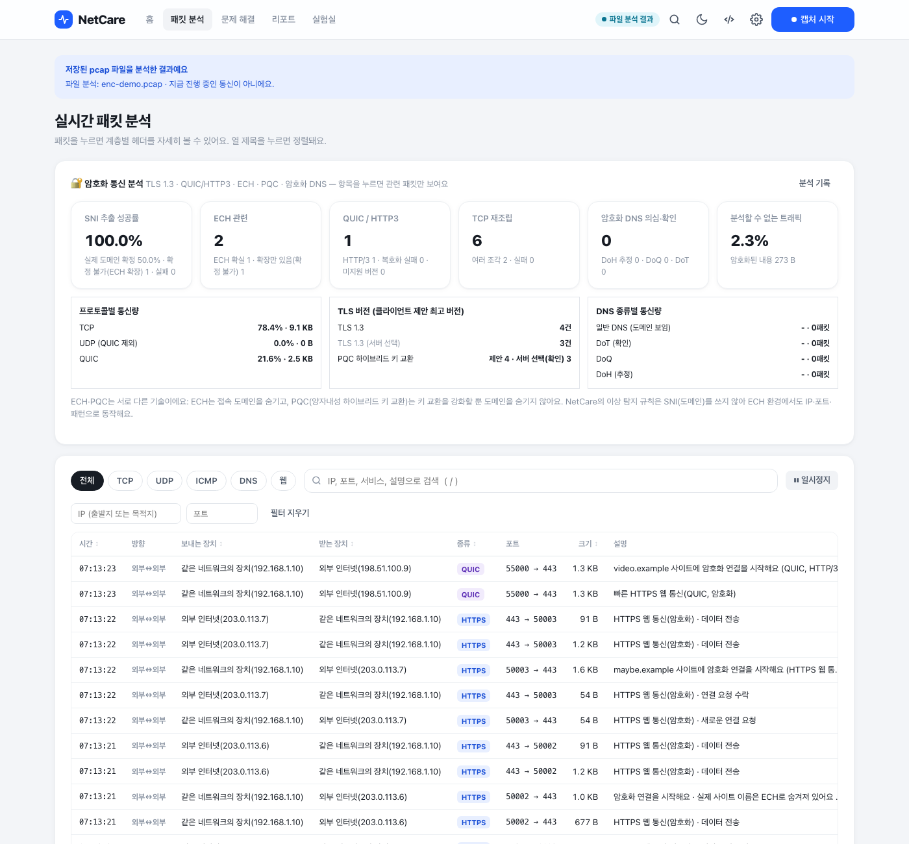

# 최신 암호화 통신 대응 (TCP 재조립 · QUIC · ECH · DoH/DoQ · PQC)

작성: 2026-11-23 · 대상 코드: `netcare/encrypted/` (신규), `capture/parser.py`·`capture/engine.py`·`storage/db.py`·`api/server.py`·`web/js/views/encrypted.js` (연결부)

## 1. 작업 전 코드 분석 결과

| 항목 | 기존 구현 | 문제 |
|---|---|---|
| SNI | `parse_tls()`가 패킷 1개의 페이로드만 해석 | ClientHello가 여러 세그먼트로 나뉘면 실패. 최신 Chrome은 PQC 키 공유(1,216B) 때문에 ClientHello가 1,500B를 넘어 **거의 항상 2개로 나뉨** |
| TLS 버전 | 레코드 헤더 버전만 | TLS 1.3도 1.2로 보임 (`supported_versions` 미해석) |
| ALPN·지원 그룹·Key Share | 없음 | HTTP/2·HTTP/3·PQC 구분 불가 |
| QUIC | UDP 443을 이름만 "QUIC"으로 | Initial 미해석 → QUIC 접속 도메인 0% |
| DNS | 53번 평문만 | DoT는 포트 이름만, DoH·DoQ 구분 없음 |
| 탐지 규칙 | SNI를 쓰는 규칙 없음 (IP·포트·플래그·흐름 기반) | 구조상 ECH의 영향은 없음 → 그대로 유지, 설명에 명시 |

## 2. 구현 (모두 `netcare/encrypted/`에 분리)

| 모듈 | 내용 |
|---|---|
| `tls_hello.py` | ClientHello·ServerHello 완전 해석: 실제 버전(supported_versions), SNI, ALPN, 지원 그룹, Key Share, PQC 그룹(X25519MLKEM768 등), ECH(outer/inner)·ESNI, GREASE 제외. SNI를 **보이는 이름 / 실제 도메인 / ECH 공개 이름**으로 분리하고 확정할 수 없으면 비워 둠. DNS HTTPS 레코드의 ECHConfig에서 공개 이름 학습 |
| `reassembly.py` | TCP 순서 번호 기반 재조립: 순서 뒤바뀜, 중복·재전송, 부분 겹침(내용이 다르면 '충돌'로 계수 → TCP 주입 탐지에 전달), 누락(시간 초과·연결 종료 시 실패 사유 기록), SYN 없이 시작한 연결, 32KB·4,096흐름 상한, 완성 즉시 버퍼 해제 |
| `quic.py` | RFC 9001·9369 Initial 키 도출(v1·v2·draft-29), 헤더 보호 해제·AES-GCM 복호화, CRYPTO 프레임 재조립(여러 Initial·섞인 순서), 서버 Initial의 ServerHello, 서버가 정한 새 CID·길이 0 CID 처리, 실패 사유(미지원 버전·복호화 실패·패킷 손실·버전 협상) |
| `dns_class.py` | 일반 DNS(확인·도메인 표시) / DoT(TCP 853 + TLS → 확인) / DoQ(QUIC ALPN `doq` → 확인) / DoH(**추정만**: 알려진 DoH 서버 이름·공용 DNS IP·DDR 조회, 신뢰도와 근거 표시). 443이라는 이유만으로 DoH라 하지 않음 |
| `analyzer.py` | 엔진이 패킷마다 호출. 결과를 패킷에 붙이고(`tags`, 설명 문구), 화면용 통계 집계 |

화면: 패킷 분석 상단 **암호화 통신 분석** 패널(SNI 추출률·실제 도메인 확정률, ECH, QUIC/HTTP3, TCP 재조립, 암호화 DNS, 분석 불가 트래픽, 프로토콜·TLS 버전·DNS 종류별 통신량). 항목을 누르면 관련 패킷만 표시(`/api/packets?tag=`), **분석 기록**에서 핸드셰이크별 상태, 패킷 상세에 재조립·확장 필드(전문가 모드 원본 값). 문제 해결 상세에는 모든 탐지에 **확인됨/추정됨 · 탐지 방식 · 분석할 수 없었던 정보**를 표시.

## 3. 검증

### 3.1 시뮬레이션 (단위·통합 테스트, 합성 패킷)
`tests/test_tls_reassembly.py`(12), `test_quic.py`(11), `test_encrypted_analyzer.py`(10): QUIC 키가 **RFC 9001 부록 A·RFC 9369 부록 A 테스트 벡터와 일치**, 분할·섞임·중복·충돌·누락·SYN 없음·메모리 상한, Initial 2개 분할·프레임 섞임·새 CID·길이 0 CID·손실·미지원 버전, ECH 상태 분리, DNS 종류 판정, pcap → 엔진 → DB 태그 → API 전 과정. 전체 테스트 122개 통과, UI E2E 71/71(JS 오류 0).

### 3.2 실제 네트워크 캡처 (macOS, 유선 en5, 2026-11-23)
공격 트래픽 없이 일반 웹 접속·DNS 조회만 발생시켰습니다. 정답은 Cloudflare 진단 페이지(`/cdn-cgi/trace`)가 돌려준 실제 값(`sni=`, `kex=`, `http=`)입니다.

| # | 시험 | 패킷 수집 | 프로토콜 식별 | SNI | DNS 도메인 | 재조립 | 정답과 일치 | 한계·비고 |
|---|---|---|---|---|---|---|---|---|
| 1 | 일반 HTTP (curl, example.com) | ✅ | ✅ HTTP | 해당 없음 | ✅ example.com | 해당 없음 (재조립 실패로 세지 않음) | ✅ | 첫 시도(neverssl.com)는 상대 서버 응답 없음으로 재시도 |
| 2 | 일반 HTTPS (curl, OpenSSL 3.0) | ✅ | ✅ TLS | ✅ 확인됨 www.example.org | ✅ | 1조각 | ✅ | |
| 3 | ClientHello 분할 (Chrome) | ✅ | ✅ | ✅ 보이는 이름 읽음 | - | ✅ 2조각 재조립 37건 | ✅ | Chrome은 GREASE ECH를 붙여 '실제 도메인 확정'은 하지 않음(설계대로) |
| 4 | TLS 1.3 | ✅ | ✅ TLS 1.3 56건 + 서버 선택 56건 | - | - | - | ✅ `tls=TLSv1.3` | |
| 5 | QUIC·HTTP/3 (Chrome, cloudflare-quic.com) | ✅ | ✅ QUIC v1, ALPN h3 | ✅ 보이는 이름 읽음 | - | ✅ Initial 2개의 CRYPTO 재조립 | ✅ `http=http/3` | Initial 104개 복호화, 실패 0 / ServerHello 16/16. 1-RTT 이후 내용은 볼 수 없음 |
| 6 | ECH (Chrome 보안 DNS, crypto.cloudflare.com) | ✅ | ✅ | ✅ **분석 제한**: 공개 이름 cloudflare-ech.com만, 실제 도메인 비움 | - | ✅ 2조각 | ✅ `sni=encrypted` | 보안 DNS 없이 접속하면 정답 `sni=plaintext` → NetCare "확정 불가"(추측하지 않음). tls-ech.dev의 공개 이름은 정적 목록에 추가, DNS HTTPS 레코드 학습은 이 망의 DNS가 TYPE65에 응답하지 않아 **단위 테스트로만 검증** |
| 7 | 일반 DNS (dig) | ✅ | ✅ 일반 DNS(확인) | - | ✅ | - | ✅ | |
| 8 | DoH (curl `--doh-url`, Chrome 보안 DNS) | ✅ | ✅ **추정됨(높음)**: SNI cloudflare-dns.com / chrome.cloudflare-dns.com (TCP·QUIC) | - | ❌ 표시 안 함(볼 수 없음) | - | ✅ | DoH는 설계상 '확인됨'이 될 수 없음 |
| 9 | DoQ (aioquic → dns.adguard-dns.com:853) | ✅ | ✅ **확인됨**: QUIC ALPN `doq` | ✅ | ❌ 표시 안 함 | ✅ | ✅ | |
| 10 | 하이브리드 키 교환 (Chrome) | ✅ | ✅ 제안 52건, 서버 선택(확인) 50건 X25519MLKEM768 | - | - | - | ✅ `kex=X25519MLKEM768` | curl(OpenSSL 3.0)은 ML-KEM 미지원 → PQC 없음으로 정확히 표시 |

실측 중 발견해 고친 문제: (1) TLS가 아닌 연결(HTTP 등)이 재조립 실패로 집계됨(41건 → 2건 → 0건), (2) 서버가 새 Connection ID를 정한 뒤의 QUIC Initial 복호화 실패(32건 → 0건), (3) 캡처 전에 열린 연결 중간의 핸드셰이크 레코드를 실패로 집계, (4) ECH 확장이 있는데 쉬운 설명이 도메인을 단정하던 문구.

DoT 실측은 하지 않았습니다(클라이언트 없음, 단위 테스트만).

## 4. 할 수 없는 것 (정직한 한계)
- **ECH 안쪽 실제 도메인은 볼 수 없고 추측하지 않습니다.** 브라우저는 ECH를 쓰지 않을 때도 가짜(GREASE) ECH를 붙이므로, ECH 확장만으로는 실제 사용 여부도 대부분 확정할 수 없습니다. 확정하는 경우: 공개 이름 목록·관찰한 DNS HTTPS 레코드와 일치할 때.
- **DoH는 추정만 가능합니다.** 내용이 일반 HTTPS와 같아 패킷으로 확정할 수 없습니다. 근거와 신뢰도를 함께 표시합니다.
- **QUIC은 Initial(첫 패킷)만 읽습니다.** 이후 패킷과 HTTP/3 요청·응답은 협상된 키로 암호화되어 볼 수 없습니다. ALPN은 클라이언트가 '제안'한 목록입니다(서버 선택 값은 암호화 영역).
- PQC는 키 교환을 강화할 뿐 도메인을 숨기지 않습니다. 화면에서 ECH와 분리해 표시합니다.
- IP 주소만으로 사이트를 단정하지 않습니다(CDN·공유 IP). 탐지 규칙은 IP·포트·패턴 기반이며 SNI를 쓰지 않습니다.
- 재조립은 핸드셰이크 구간(ClientHello·ServerHello)만 합니다. 응용 데이터 재조립은 하지 않습니다(암호화되어 의미 없음, 메모리 절약).
