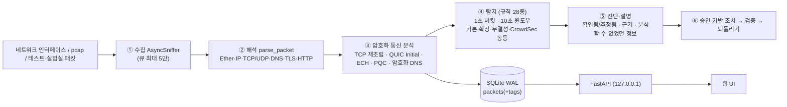
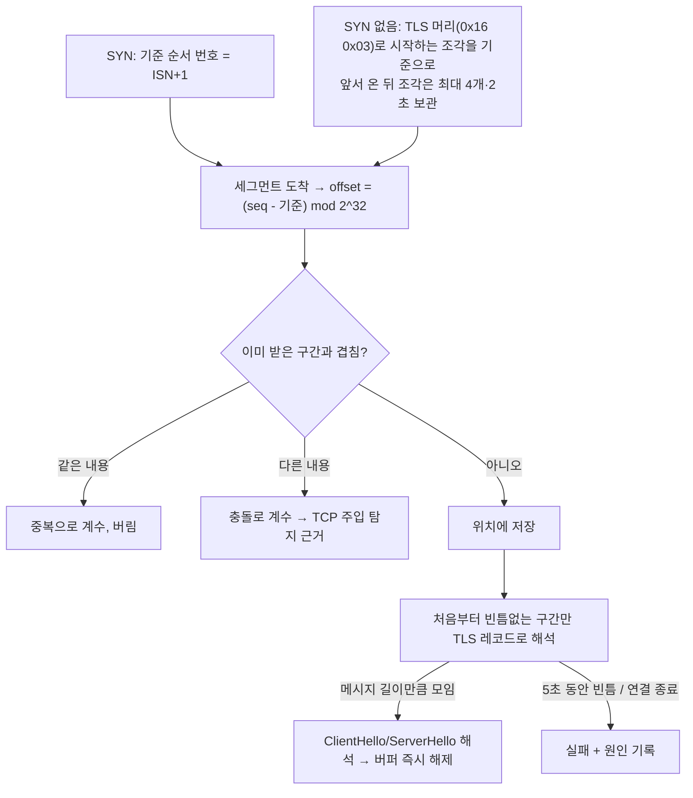
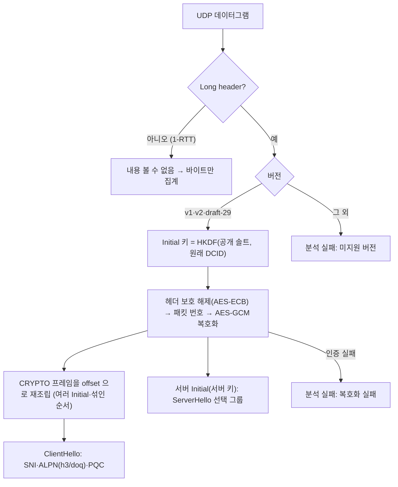

# NetCare 종합 검증 보고서 — 성능·탐지 신뢰성·암호화 통신 분석

작성: 2026-11-23 · 코드 기준: `main` (암호화 통신 분석 반영 이후) · 측정 환경: macOS 26.5.2, Python 3.13.9, 유선 en5(IPv4), Apple Silicon 노트북

> 이 보고서의 모든 수치는 실제로 실행한 테스트 결과입니다. 실행하지 않은 항목은 **미검증**으로 표시했습니다.
> 자동 테스트: pytest 133개 통과(이번 작업에서 안정성·회귀 테스트 추가), UI E2E 71/71.
> 데이터 출처는 세 가지로 구분합니다: **실제 캡처**(내 컴퓨터 en5) · **공개 데이터셋**(CSE-CIC-IDS2018) · **합성 데이터**(가상 실험실·테스트 코드).

## 1. 전체 시스템 아키텍처

| 계층 | 주요 모듈 | 비고 |
|---|---|---|
| 수집 | `capture/engine.py` | 캡처 스레드는 큐에 넣기만, 처리 스레드가 해석·저장 (500개/0.3초 묶음) |
| 해석 | `capture/parser.py` | 패킷 1개 → 레코드(dict). 체크섬·HTTP·FTP 응답 코드·RTP 포함 |
| 암호화 분석 | `encrypted/` | 패킷 단위 해석의 한계를 재조립·QUIC 복호화로 보완 (3장) |
| 탐지 | `detection/` | `detector`(기본+EWMA), `advanced`(스푸핑·품질), `integrity`(체크섬·주입·재전송), `crowdsec_compat`(CrowdSec 동등+확장) |
| 진단·조치 | `diagnosis/`, `remediation/` | 탐지 규칙은 SNI 를 쓰지 않음 → ECH 환경에서도 동작 |
| 실험실 | `simlab/` | 별도 엔진·DB, 패킷 전송 함수 없음(정적 검사 테스트) |
| 배포 | Dockerfile, NetCare.exe, CI | GitHub Actions: 3개 OS 테스트, exe 실행 점검, 도커 이미지, 공개 데이터셋 벤치마크 |

## 2. 암호화 통신 분석 구조

| 모듈 | 하는 일 | 상태 표시 |
|---|---|---|
| `tls_hello` | ClientHello/ServerHello: 실제 버전(supported_versions), SNI, ALPN, 지원 그룹, Key Share, PQC, ECH·ESNI, GREASE 제외 | SNI 를 보이는 이름 / 실제 도메인 / ECH 공개 이름으로 분리 |
| `reassembly` | TCP 순서 번호 기반 재조립 (핸드셰이크 구간만) | 완성 / 실패(원인) |
| `quic` | Initial 키 도출·복호화, CRYPTO 재조립, ServerHello | 확인됨 / 실패(미지원 버전·복호화 실패·손실) |
| `dns_class` | 일반 DNS · DoT · DoQ · DoH | DoT·DoQ 확인됨 / DoH 는 추정만 |
| `analyzer` | 엔진 연결, 패킷 태그, 통계, 분석 기록 | 확인됨·추정됨·분석 제한·분석 실패 |

### 2.1 TCP 재조립 과정

상한: 흐름당 32KB, 동시 4,096흐름(초과 시 가장 오래된 흐름부터 버림). TLS 가 아닌 연결은 대상이 아니며 실패로 세지 않음.

### 2.2 QUIC Initial 처리 과정

서버가 정한 새 Connection ID, 길이 0 CID 는 주소·포트 쌍으로 원래 DCID 를 찾아 처리한다.

## 3. 탐지 규칙과 평가 지표

규칙 28종: 기본 9 + 확장 13(스푸핑·품질·크기·비율·NXDOMAIN) + 무결성 3(체크섬·TCP 주입·UDP 재전송) + CrowdSec 동등·NetCare 확장 시나리오를 묶은 3유형(웹 공격·웹 탐색·로그인 무차별 대입). 각 규칙의 조건·임계값·오탐 가능성·한계는 `detection/rules.py` 카탈로그(화면의 '탐지 규칙 보기')에 있다.

| 지표 | 정의 |
|---|---|
| TP / FN | 공격 구간(초 단위)에 기대한 유형을 탐지함 / 못 함 |
| FP / TN | 정상 구간에 무엇이든 탐지함 / 아무것도 없음 (공격 직후 윈도우 10초는 관련 유형만 허용) |
| Precision, Recall, F1, FPR | TP/(TP+FP), TP/(TP+FN), 조화평균, FP/(FP+TN) |
| 최초 탐지 시간 | 공격 시작 → 기대 유형의 첫 알림 |
| 공개 데이터셋 탐지 | 라벨의 공격 구간·공격자 주소와 맞는 종류의 알림이 있는가 |

## 4. 탐지 성능 평가

### 4.1 가상 실험실 (합성 데이터, 현재 코드로 재측정)
시나리오 13종(정상 기준선 포함) × 강도 4단계(0.25·0.5·1·2배) × 시드 3개 = **156회**, 511초 (`scripts/bench/simlab_eval.py`, 원자료 `docs/benchmark/simlab_eval.json`). 초 단위로 TP·FP·FN·TN 을 셉니다.

| 범위 | TP | FP | FN | TN | Precision | Recall | F1 | FPR |
|---|---|---|---|---|---|---|---|---|
| 전체 156회 | 1,929 | 0 | 951 | 2,208 | 100% | 67.0% | 80.2% | 0% |
| 강도 1배 (39회) | 596 | 0 | 124 | 552 | 100% | 82.8% | 90.6% | 0% |
| 강도 2배 | | | | | 100% | 88.2% | 93.7% | 0% |
| 강도 0.5배 | | | | | 100% | 55.1% | 71.1% | 0% |
| 강도 0.25배 | | | | | 100% | 41.8% | 59.0% | 0% |

시나리오별 (전체 156회 / 탐지율은 공격 실행 중 한 번이라도 탐지한 비율, 소요는 평균 최초 탐지 시간)

| 시나리오 | 탐지율 | 평균 소요 | Precision | Recall | F1 | 강도 0.25배 탐지 |
|---|---|---|---|---|---|---|
| 정상(기준선) | - | - | - | - | - | FPR 0% (480초 모두 TN) |
| ARP Spoofing | 100% | 1.5초 | 100% | 97.5% | 98.7% | ✅ |
| DNS Spoofing | 100% | 1.5초 | 100% | 97.5% | 98.7% | ✅ |
| IP Spoofing (의심) | 100% | 2.75초 | 100% | 91.3% | 95.4% | ✅ |
| Port Scanning | 100% | 2.25초 | 100% | 93.8% | 96.8% | ✅ |
| Connection Failure | 100% | 2.0초 | 100% | 95.0% | 97.4% | ✅ |
| SYN Flood | 100% | 5.0초 | 100% | 80.0% | 88.9% | ✅ |
| 반복 연결 | 75% | 3.7초 | 100% | 65.0% | 78.8% | ❌ |
| DNS Failure | 66.7% | 6.8초 | 100% | 45.8% | 62.9% | ❌ |
| Latency | 50% | 5.5초 | 100% | 38.8% | 55.9% | ❌ |
| Packet Loss | 50% | 6.0초 | 100% | 37.5% | 54.5% | ❌ |
| Jitter | 50% | 7.3초 | 100% | 34.2% | 50.9% | ❌ |
| Bandwidth (의심) | 50% | 10.0초 | 100% | 27.5% | 43.1% | ❌ |

- 공격 6종은 강도 0.25배에서도 대부분 잡지만, 품질 장애 5종은 강도 1배 미만에서 놓칩니다(임계값 미만으로 설계한 결과). Recall 손실의 대부분은 근거가 쌓일 때까지의 지연입니다.
- 오탐 알림 목록에 1건(Packet Loss 실험 중 '특정 포트 집중', 공격과 무관한 유형)이 기록됐으나, 초 단위 FP 계산에서는 공격 직후 윈도우에 걸쳐 FP 0 으로 집계됐습니다.
- **주의:** 생성기와 탐지기를 같은 프로젝트에서 만들었으므로 실제 환경 성능을 보장하지 않습니다. 성능 근거는 4.2 와 5장입니다.

### 4.2 공개 데이터셋 (CSE-CIC-IDS2018, 실제 공격 트래픽)
GitHub Actions 가 공격받은 서버의 캡처를 받아 NetCare 와 실제 CrowdSec 을 같은 입력으로 실행했습니다(`docs/benchmark/cse-cic-ids2018.md`).

| 공격 (라벨 흐름 수) | NetCare 기본·CrowdSec 동등 규칙 | NetCare 확장 규칙 | CrowdSec |
|---|---|---|---|
| SSH 무차별 대입 (187,589) | ✅ ssh_bf 51초 | - | 측정 불가 (sshd 로그 필요) |
| FTP 무차별 대입 (193,360) | 로그인 시도 없음(포트 닫힘, SYN→RST 193,392건) → 반복 연결·SYN 급증으로만 탐지 | - | 해당 없음 (vsftpd 로그 0건) |
| 웹 로그인 무차별 대입 (249 / 362) | ❌ | ✅ 342초 / 44초 | ❌ |
| XSS (79 / 151) | ❌ | ✅ 47초 / 12초 | ❌ |
| SQL 인젝션 (34 / 53) | ❌ | ✅ 270초 / 123초 | ❌ |

### 4.3 정상 트래픽 오탐 (실제 캡처)
1시간 실측(6.1절) 동안 공격은 없었으므로 모든 보안 알림은 오탐 후보입니다. 근거를 하나씩 확인했습니다.

| 알림 | 건수 | 판정 | 원인 |
|---|---|---|---|
| 데이터 손실·연결 중단·DNS 무응답·지연 | 20 | 실제 상태 (측정값) | 유선망 재전송 5~9%, 이 망의 DNS 서버가 HTTPS 형식 질의에 응답하지 않음(별도 dig 로 확인) |
| 특정 장치의 과도한 패킷 (LAN 의 다른 장치, 단방향 1,085 pps) | 2 | 실제 관측, 원인 미확인 | - |
| **IP 스푸핑 의심** | 12 | **오탐** | Google 서버가 TCP 는 TTL 116~117, QUIC(UDP) 는 TTL 53~54 로 응답 → 출발지별 TTL 기준을 프로토콜 구분 없이 써서 '급변'으로 오인 |
| **TCP 주입 의심** | 5 | **오탐(구분 불가)** | Google Cloud(34.149.66.165) 의 RST 만 TTL 이 8 낮음 = 로드밸런서가 대신 보내는 RST. 경로 위 주입 공격과 패킷만으로 구분할 수 없음 |
| **UDP 재전송 의심** | 1 | **오탐** | LAN 방송(.255) 탐색 패킷을 RTP 로 오인 |

오탐 원인 2개를 고친 뒤(TTL 기준을 출발지·프로토콜별로 분리, 방송·멀티캐스트 제외 — 회귀 테스트 추가) 10분 실측에서도 보안 알림 오탐은 **3건**이었습니다. 수정 전 1시간 18건(10분 평균 3건)과 **비율은 같아 오탐이 줄었다고 말할 수 없습니다.** 고친 원인(TCP·QUIC TTL 차이, 방송 패킷)에서 나온 오탐은 없었고, 남은 3건은 다른 원인입니다: IP 스푸핑 의심 2건(Google Cloud 34.104.35.123 이 **TCP 안에서도** TTL 117 과 54 두 무리로 응답 — 연결마다 다른 프런트엔드), TCP 주입 의심 1건(위와 같은 로드밸런서 RST). 이 두 원인은 이번에 고치지 않았습니다(9장 개선 방향).

## 5. 실제 네트워크 실측 (암호화 통신)
`docs/07_암호화통신_분석.md` 의 10개 시험(HTTP, HTTPS, ClientHello 분할, TLS 1.3, QUIC·HTTP/3, 실제 ECH, DNS, DoH, DoQ, X25519MLKEM768)은 Cloudflare 진단 페이지의 실제 값과 모두 일치했습니다. 이번 수정 후 10분 실측(일반 웹·Chrome QUIC·보안 DNS Chrome·DNS) 결과:

| 항목 | 값 |
|---|---|
| 패킷 / 버린 패킷 | 136,205 / 0 |
| ClientHello 분석 | 365건 (TLS 288, QUIC 77), SNI 추출 성공률 100%, 실제 도메인 확정률 33.2% |
| ECH | 확장 없음 121 · 확장만 있음(확정 불가) 234 · 실제 ECH 확인 10 |
| PQC 하이브리드 | 제안 294 · 서버 선택(확인) 282 |
| TCP 재조립 | 완성 576 (여러 조각 217), 실패 0, 겹침 충돌 0 |
| QUIC Initial | 540개 복호화, 실패 0, ClientHello 77 · ServerHello 77 · HTTP/3 77 |
| 암호화 DNS | DoH 추정 4흐름(확인됨 0), DoT·DoQ 이번 실측 0 |
| 불변식 검사 (분석 기록 300건) | ECH 확장이 있는데 실제 도메인을 채운 사례 **0**, ECH 미확정인데 공개 이름으로 표시한 사례 **0** |

## 6. 성능 및 안정성 테스트

### 6.1 장시간 캡처 (실제 캡처 en5, 1시간 연속, 커밋 7cb0696 코드)
일반 웹·DNS·DoH 접속을 1분마다 발생시키며 10초 간격으로 측정했습니다(`scripts/perf_monitor.py`, 원자료 `docs/benchmark/long_capture_60min.csv`). 10분·30분 값은 같은 1시간 연속 측정의 해당 시점 누적값입니다.

| 시점 | 처리 패킷 | 버린 패킷 | CPU 평균/최대 | 메모리(RSS) 끝/최대 | 초당 패킷 평균/최대 | 큐 최대 | 캡처→DB 반영 지연 중앙값/95%/최대 | 재조립 버퍼(동시 흐름) 최대 | 재조립 완성/실패 | QUIC Initial / 복호화 실패 |
|---|---|---|---|---|---|---|---|---|---|---|
| 10분 | 165,855 | 0 | 13.7% / 21.1% | 184 / 213 MB | 275 / 676 | 0 | 0.18 / 0.36 / 0.37초 | 17 | 550 / 20 | 767 / 300 |
| 30분 | 460,189 | 0 | 13.5% / 21.1% | 207 / 213 MB | 255 / 676 | 21 | 0.20 / 0.37 / 0.48초 | 17 | 1,075 / 22 | 1,135 / 539 |
| 60분 | 857,711 | 0 | 13.3% / 26.4% | 265 / 306 MB | 238 / 1,428 | 6,380 | 0.19 / 0.39 / 0.53초 | 17 | 1,846 / 23 | 1,422 / 728 |

- **누락:** 응용 단계(큐 초과)에서 버린 패킷 0. 순간 1,428 pps 에 큐가 6,380 까지 찼다가 비워졌습니다(상한 50,000). 커널(libpcap) 단계 누락 수는 측정하지 않았습니다(**미검증**).
- **재조립 버퍼:** 동시에 남아 있는 흐름은 최대 17개로 늘지 않았습니다(상한 4,096).
- **메모리:** 시작 199MB → 끝 265MB(최대 306MB). DB 는 보존 한도(224MB)에서 멈췄습니다. 상한 있는 자료구조는 6.2 에서 상한이 지켜짐을 확인했지만, 이 66MB 증가의 출처는 확인하지 못했습니다. **수 시간 이상 누수 시험은 미검증.**
- **QUIC 복호화 실패 51%(728/1,422):** 같은 시간대에 저장된 패킷(마지막 약 20분, Initial 207개)을 이전 코드와 수정 코드로 각각 재생하면 둘 다 실패 0 이었습니다. 즉 저장된 패킷으로는 재현되지 않고, 장시간 실행 중 쌓이는 상태에 의존하는 문제로 추정되지만 **원인은 확정하지 못했습니다.** 이번에 '서버 Initial 을 짝 없이 받으면 복호화하지 않고 분석 제한으로 표시'하도록 고쳤고, 수정 후 10분 실측은 540개 중 실패 0 이었습니다. **수정 후 1시간 재측정은 미검증.**

### 6.2 흐름 상한·처리량 (스트레스, 합성 입력, `scripts/stress_limits.py`, 원자료 `docs/benchmark/stress_limits.json`)

| 대상 | 넣은 흐름 | 결과 크기 | 상한 | 최대 메모리 |
|---|---|---|---|---|
| TCP 재조립 버퍼 | 100,000 | 4,096 (95,904개 축출) | 4,096 | 4.0 MB |
| 추적하지 않는 조각 보관 | 20,000 | 2,048 | 2,048 | (위에 포함) |
| QUIC 연결 | 12,000 | 4,096 (주소 쌍 8,192) | 4,096 | 8.2 MB |
| 암호화 흐름 표시 | 120,000 | 50,000 | 50,000 | 20.1 MB |
| 무결성(TCP 흐름) / CrowdSec 동등 버킷 | 60,000 | 20,000 / 20,000 | 20,000 / 20,000 | 95.2 MB |

처리량(메모리 추적 끔, 같은 시간에 캡처가 돌던 상태): 해석→암호화 분석→탐지 **약 22,800 pps**, 엔진 전체(DB 저장 포함, pcap 가져오기) **약 8,500 pps**, 버린 패킷 0. 1시간 실측 최대치(1,428 pps)의 약 6배입니다(엔진 전체 기준).

### 6.3 암호화 분석 안정성 (`tests/test_encrypted_robustness.py`, 합성)
- 무작위 바이트 3,000건(ClientHello·ServerHello), 무작위 QUIC long header 1,500건, 무작위 TCP 조각 3,000건, 실제 ClientHello 비트 변형 2,000건: **예외 0** (이 과정에서 잘린 QUIC 패킷의 헤더 해석 예외 버그 1개를 발견해 수정).
- ECH/GREASE 판정 7가지: ECH 없음만 '확인됨', 알려진 공개 이름만 'ECH 확실', 나머지는 확정하지 않음. 공개 이름을 모르는 실제 ECH 는 '확정 불가'로 남는 한계를 테스트로 기록.
- DoH 오분류: 인기 HTTPS 사이트 30곳 중 DoH 로 분류 **0곳**. DoH 는 어떤 경우에도 '확인됨'이 되지 않음. 한계: 1.1.1.1 홈페이지(one.one.one.one) 방문은 DoH '추정'으로 보임.
- DoT·DoQ: TCP 853+TLS → DoT 확인, TLS 전 → 추정, QUIC ALPN doq → DoQ 확인, 853 이 아닌 일반 HTTP/3 → DNS 아님.

## 7. CrowdSec 비교 실험 조건 재검토

| 점검 항목 | 결과 |
|---|---|
| 같은 공격 데이터 | ✅ 같은 pcap. NetCare 는 패킷, CrowdSec 은 같은 패킷에서 만든 로그 |
| 로그 제공의 공정성 | ✅ HTTP: 공격받은 서버의 HTTP 요청 10,794건·13,591건이 짝 누락 0 으로 Apache 로그가 됨. 이 서버에는 HTTPS(443) 통신이 없어 'CrowdSec 은 HTTPS 로그도 본다'는 장점이 이번 데이터에는 작용하지 않음 |
| | ⚠️ SSH: 암호화되어 sshd 인증 실패 로그를 만들 수 없음 → CrowdSec **측정 불가** (실제 서버라면 sshd 로그로 탐지 가능) |
| | ⚠️ FTP: 포트가 닫혀 로그인 시도 자체가 없음 → 두 시스템 모두 'FTP 무차별 대입'으로는 **해당 없음** |
| | ⚠️ 방화벽 차단 로그(iptables)는 만들지 않음 → CrowdSec 의 포트 스캔 시나리오는 이번 비교에서 제외 |
| 기본 vs 확장 구분 | NetCare 의 CrowdSec 동등 조건 결과는 실제 CrowdSec 과 **완전히 일치**: 2월 14일 같은 스캐너(120.76.195.219)를 같은 시나리오 2개로 둘 다 탐지, 웹 공격일은 둘 다 0건. 웹 공격 탐지는 **전부 NetCare 확장 규칙**(디코딩 후 비교·SQL 문법·로그인 반복) |
| 비교 불가 표시 | SSH(CrowdSec 측정 불가), FTP(해당 없음), HTTPS 웹 공격(이번 데이터에 없음, 실제로는 NetCare 가 판정 불가) |

**탐지 시간을 단순 비교하면 안 되는 이유**
- 기준 시각이 다릅니다: CrowdSec 알림의 `start_at` 은 버킷에 처음 들어온 **사건 시각**(12:47:15)이고, NetCare 의 시각은 조건을 넘어 **알림을 낸 시각**(12:47:17/21)입니다. 같은 탐지라도 NetCare 가 늦어 보입니다.
- NetCare 는 1초 단위로 평가하므로 최대 1초가 더해지고, CrowdSec 은 time-machine 재생이라 실제 배포에서의 로그 기록·수집 지연(파일 flush, tail 주기)이 빠져 있습니다.
- 공개 데이터셋의 '소요'는 라벨 구간 시작부터 잰 값이라, 라벨 구간이 실제 공격보다 넓거나 좁으면 함께 변합니다(라벨 시각은 오전/오후 표시 없는 12시간제여서 보정함).

## 8. 현재 기술적 한계
- ECH 안쪽 실제 도메인은 볼 수 없고, 공개 이름을 모르는 실제 ECH 는 GREASE 와 구분할 수 없습니다(Chrome 접속 대부분이 '확정 불가').
- DoH 는 패킷만으로 확정할 수 없습니다(추정·신뢰도만). QUIC 은 Initial 만 읽습니다.
- HTTPS 웹 공격은 판정하지 못합니다. SSH 무차별 대입은 연결 수로 근사합니다('의심').
- 실제 환경 오탐: 같은 IP 에 여러 TTL 무리(Google Cloud 등)가 있으면 IP 스푸핑 의심, 로드밸런서 RST 는 TCP 주입 의심으로 보일 수 있습니다.
- 장시간 실행 시 QUIC 복호화 실패(원인 미확정)와 메모리 66MB 증가(출처 미확인).
- 미검증: 커널 단계 패킷 누락, 수 시간 이상 장시간·누수, 수정 후 1시간 재측정, DoT 실측, DNS HTTPS 레코드로 ECH 공개 이름 학습 실측, Windows 실제 캡처(CI 는 캡처 없이 실행 점검만), 10Gbps 급 고부하.

## 9. 향후 개선 방향
1. TTL 기준을 '여러 개의 평소 값'으로 학습(같은 IP 의 여러 프런트엔드 허용) → IP 스푸핑 오탐 감소.
2. 서버별 RST TTL 프로필: 같은 서버가 여러 연결에서 일정하게 다른 TTL 의 RST 를 보내면 그 서버의 정상 동작으로 학습.
3. QUIC 분석 진단 카운터(실패 시 DCID·주소 쌍·직전 상태 기록)를 넣어 장시간 실패 원인 확정, 수정 후 1시간 이상 재측정.
4. 메모리: 장시간(6~24시간) 측정과 tracemalloc 스냅샷 비교로 증가 출처 확인.
5. 커널 단계 누락(pcap 통계) 수집, Windows 실제 캡처 검증.
6. CrowdSec 비교 확장: sshd 로그가 포함된 데이터셋, iptables 로그 생성으로 포트 스캔 비교, HTTPS 서버가 있는 데이터셋.
